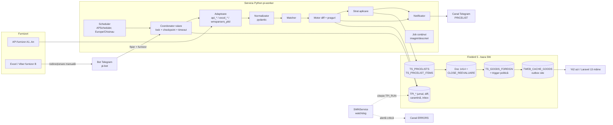
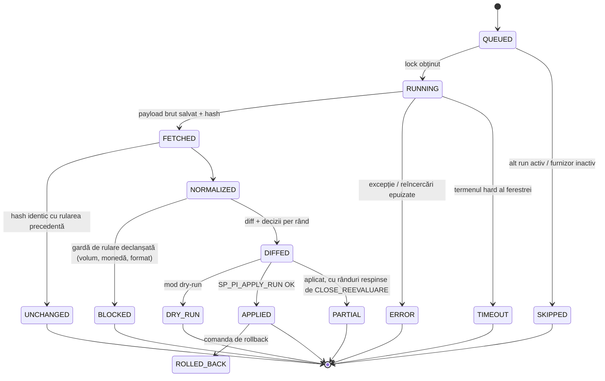
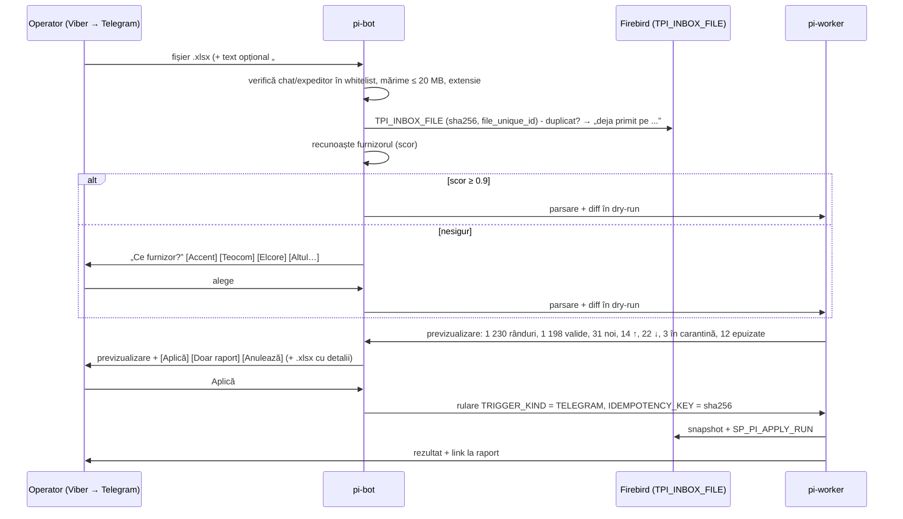

# Plan: import automat de pricelisturi (Python + Firebird 5)

Data: 27 oct 2026 · Autor: plan pregătit pentru Prime Store SRL / fantastic.md · Stare: **propunere, nimic implementat**

## Stare implementare (27 oct 2026, seara)

**Etapa 1 (MVP dry-run) e scrisă și testată**: `PriceImport/` (detalii în `PriceImport/CLAUDE.md`). Pe SW nu s-a scris nimic.

| Ce | Stare |
|---|---|
| DDL `DB Model/price_import_stage1.sql` (+ `_rollback`, `price_import_grants.sql`) | **Rulat pe SW 27 oct 2026** (împreună cu `price_import_grants.sql`), verificat: 6 tabele + `VW_TPI_RUN`, 18 indecși activi (inclusiv cel parțial), 7 furnizori, canalul `PRICELIST_IMPORT` inactiv, drepturile pentru `PRICEIMPORT`; constrângerile încercate pe SW cu ROLLBACK. Utilizatorul `PRICEIMPORT` **nu e creat încă** (DBA) |
| Serviciu Python: adaptoarele `external_plid` (WMSParsers/frame78/Ultra) + `agropiese` (API), diff, praguri, gărzi, ferestre, raport Telegram, CLI, scheduler, heartbeat | 67 de teste (59 unitare + 8 de integrare pe Firebird embedded) |
| Echivalența cu cele 4 reevaluări WMS pe date reale (`compare-wms`, doar citire pe SW) | **Identic** pe PLID 6115 (AgroPiese: 62 / 119 / 952 / 4) și 6111 (NATVEX: 0 / 0 / 1187 / 0) |
| Previzualizare pe SW (`preview`, doar citire) | Rulată pentru Accent, Ultra, AgroPiese, NATVEX, inclusiv din containerul Docker |
| Prima rulare dry-run pe SW (27 oct, 23:10, fără Telegram) | RUNID 6–12: 6 × DRY_RUN, DMLink BLOCKED (garda de volum: 5 054 vs 10 802 poziții); 13 257 de schimbări în `TPI_ITEM_CHANGE`, nimic aplicat |
| Imaginea Docker (`compose.yaml`) | Se construiește; clientul `libfbclient2` se conectează la SW. Nedeployată pe .240 |

### Etapa 2 (28 oct 2026): aplicarea, scrisă și testată local; **oprită implicit**

| Ce | Stare |
|---|---|
| DDL `DB Model/price_import_stage2.sql` (+ `_rollback`, `price_import_stage2_grants.sql`) | **Rulat pe SW 28 oct 2026**, verificat: 5 tabele, `TPI_RUN.BASELINE`, procedurile DEFINER valide, 14 indecși, drepturile (PRICEIMPORT: doar SELECT pe `TS_GOODS_FOREIGN`) |
| `apply-test` pe SW, AgroPiese PLID 6115 (RUNID 13, lotul 1) | 3 documente 1414 reale (noi 62, mărite 812, scăzute 4), **0 respinse** de `CLOSE_REEVALUARE`, ~2,5 s; ROLLBACK: prețurile AgroPiese, documentele 1414, `TDB_GOODS_FLAGS` și PLID 6115 identice cu starea dinainte. S-au consumat doar DOCID 2182230–2182232 |
| `SP_PI_APPLY_KIND` (DEFINER): document 1414 per tip, `ADJUST_RRP_REEVALUATION`, `CLOSE_REEVALUARE` cu scoaterea produsului respins și reluare | Testat local cu un `CLOSE_REEVALUARE` simplificat; procedura reală se verifică doar pe SW (`apply-test`, cu ROLLBACK) |
| Python: `BuildRow` portat, aplicare (TEST_ONLY / real), snapshot pentru adaptoarele native, carantină + aprobări cu memorie de 30 de zile, anulare compensatorie, deduplicarea alertelor, outbox `TPI_GOODS_EVENT` | 83 de teste (inclusiv drepturile utilizatorului `PRICEIMPORT` în embedded) |
| `SP_PI_WATCHDOG` (heartbeat + fereastră nerulată → `ERRORS`, deduplicat) | Testat local; **de programat în SWNService** (DB Service Manager: sarcină `SP_PI_WATCHDOG`, la interval de 15 min) |
| Regulă nouă | O rulare comparată cu pricelistul precedent (`TPI_RUN.BASELINE = 'prev'`, PLID deja prelucrat de WMS) nu se aplică și nu creează carantină |

**Prima aplicare reală (28 oct 2026, cerută de user):** rularea 13, AgroPiese PLID 6115 → documentele 1414 **2182233** (62 produse noi), **2182234** (812 prețuri mărite), **2182235** (4 scăzute), toate închise, 0 respinse, firma 307225, utilizatorul 204; PLID 6115 marcat prelucrat (FLAGS 18); 878 de evenimente în `TPI_GOODS_EVENT`. Efect pe site (`get_goods_price(id, 1, 498)`): 62 de produse au intrat din nou în vânzare (212 703 lei în total); din celelalte 816, 146 și-au schimbat prețul (mediana +0,44%, între −2,54% și +4,94%), 670 nu (variația costului sub pasul de rotunjire al politicii sau alt furnizor e mai ieftin); suma lor +0,07%. Anulare posibilă cu `python -m priceimport rollback 13`.

**Nefăcut din etapa 2:** avertismentul din frame78/WMSParsers când PriceImport are o rulare activă (Delphi); consumatorul `TPI_GOODS_EVENT` (cache site / Meilisearch); comenzile de carantină din botul Telegram (etapa 3; acum sunt în CLI).

**Ordinea de pornire:** stage2.sql + grants pe SW → `apply-test` pe un PLID neprelucrat (documente reale, ROLLBACK) → `FLG_AUTO_APPLY = 1` pe 1–2 furnizori → `PI_APPLY_ENABLED=true` pe serviciu → ceilalți furnizori.

### Etapa 3 (28 oct 2026): botul Telegram pentru furnizorii manuali, scris și testat local

| Ce | Stare |
|---|---|
| DDL `DB Model/price_import_stage3.sql` (+ `_rollback`, `_grants`): `TPI_BOT_USER`, `TPI_INBOX_FILE`, `TPI_FILE_RULE`, `TPI_BOT_STATE` | **Rulat pe SW 28 oct 2026**, verificat: 4 tabele goale, 9 indecși activi, cheile (inclusiv FK spre `TPI_SUPPLIER`), drepturile PRICEIMPORT |
| `pi bot`: recepția fișierelor, recunoașterea furnizorului (`#ID`, reguli, antetul învățat, coduri comune cu `TS_GOODS_FOREIGN`), previzualizare + `.xlsx`, butoanele Aplică / Doar raport / Anulează, comenzile `/status /carantina /aproba /respinge /run /mute` | 6 teste cap-coadă cu Bot API simulat; 100 de teste în total |
| Adaptorul `excel`: antet automat RO/RU/EN, mapare YAML, șablonul `wms16` (frame78), titluri de grupă = categorie, CSV cp1251/UTF-8, protecție zip-bomb | 6 teste; **netestat pe fișiere reale de la furnizori** (lipsesc mostre) |
| CLI: `bot`, `bot-user`, `supplier-add`, `mapping-suggest`, `import-file` | — |
| Docker: serviciul `pi-bot` în `compose.yaml` (imaginea 0.3) | Imaginea se construiește; nedeployată |

Abatere de la plan: botul folosește un client Bot API propriu (sincron, peste `httpx`), nu aiogram. Sunt doar 7 metode, codul rămâne sincron ca restul serviciului și se testează cu `respx`.

**Pentru pornire:** un bot nou din @BotFather (token în `secrets/bot_token.txt`), `pi bot-user <ID Telegram> <nume> --role APPLY` pentru fiecare operator, `pi supplier-add <ID>` pentru fiecare furnizor manual, apoi 2–3 fișiere reale per furnizor ca să verificăm maparea.

### Etapa 4a (28 oct 2026): potrivirea produselor noi, pe SW

| Ce | Stare |
|---|---|
| DDL `DB Model/price_import_stage4.sql` (+ `_rollback`, `_grants`): `TPI_MATCH_CANDIDATE`, `SP_PI_LINK_GOODS` (DEFINER, rând GF cu FLAGS = 0) | Testat local de 2 ori + rollback. **Rulat pe SW 28 oct** (tabela, 3 indecși, procedura DEFINER validă, drepturile PRICEIMPORT) |
| Motorul (`matching.py`): EAN / cod la alt furnizor / MPN / denumire, cu gărzile de mai jos; job zilnic 21:30, CLI, `/potriviri` în bot, rândul din raport | 9 teste noi; 109 în total |
| Evaluare pe SW (doar citire), ultimele rulări | Olis: 3/27 (toate `CODE` HECHT, corecte). Ultra: 2/54. Triomac: 5/43 (MX Keys corect, restul slabe, sub 0,85). AgroPiese: 30/4 435, aproape doar anvelope corecte; restul sunt piese auto pe care catalogul nu le are |

Prima potrivire pe SW (28 oct, doar propuneri, nimic legat): 35 de propuneri pentru 22 de coduri. Olis 3, Ultra 2, Triomac 5, AgroPiese 25; Tritel, Darwin, NexDistribution 0. Peste 0,85 sunt aproape toate corecte (HECHT, anvelopele Lassa/Michelin, becurile Philips H15/H16). Sub 0,85 majoritatea erau greșite (alt model de anvelopă din aceeași gamă, capac de obiectiv → cameră). De aceea pragul minim de salvare a fost ridicat la 0,85, iar cele 18 propuneri de sub prag au fost marcate `SUPERSEDED`. Au rămas 17 propuneri pentru 13 coduri.

Ce a corectat evaluarea pe date reale:
- **Același cod la produse diferite:** plăcuțele de frână `B111152` ↔ puzzle-ul `B-111152`; acum `CODE` / `MPN` cer brand sau cuvinte comune.
- **Măsurile luate drept coduri:** `114cm`, `80W90`.
- **Generația modelului:** Pilot Sport 5 ↔ Pilot Super Sport.
- **Becurile:** 24V ↔ 12V.
- **Denumirile generice:** „Фильтр воздушный” ↔ un cooler. Acestea erau ~550 de propuneri false doar la AgroPiese.

**Criteriul din plan (≥ 80% legate sau propuse la furnizorii cu EAN) nu se poate măsura acum:** niciun pricelist nu aduce EAN, iar `TS_GOODS_BARCODE` e goală. Partea mare a produselor nelegate (piesele auto AgroPiese) nu există deloc în catalog, deci trebuie create, nu legate.

### Etapa 4c (28 oct 2026): adaptoarele WMSParsers portate în Python

| Ce | Stare |
|---|---|
| `accent`, `dmlink`, `olisgrup`, `nex`, `triomac` (doar prețurile, aceleași reguli ca în Delphi) + `pi compare-source` | 16 teste noi; 125 în total |
| Echivalența pe SW (descărcare reală, fără scriere), față de ultimul PLID Delphi | Accent 2 599 / PLID 6114 (27 oct): 2 595 de coduri comune, prețuri diferite doar la 3 indicative și 84 de costuri (oscilații de curs). DMLink 5 225 / 6034 (5 oct), Olis 4 207 / 6069 (14 oct), Nex 426 / 6092 (19 oct), Triomac 1 191 / 6052 (9 oct): diferențele vin din timpul scurs și din API-ul nou SCOP (categoriile) |
| Previzualizarea completă (diff + praguri + gărzi) pe toți 5 | Nicio rulare BLOCKED. Carantina: Accent 118, DMLink 465 (458 de scăderi > 20% față de 5 oct), Olis 1 162, Triomac 6, Nex 0 |
| DDL `DB Model/price_import_stage4c.sql` (+ `_rollback`): `TS_API_CONFIG` `ACCENT` + comutarea `ADAPTER_CODE` | Testat local (re-rulare, parola neînlocuită, rollback). **Rulat pe SW 28 oct 2026**: cei 5 furnizori pe adaptoarele native (`FLG_AUTO_APPLY` = 0, deci tot dry-run), login-ul Accent verificat cu datele din `TS_API_CONFIG` |

Găsit la portare:
- **Olis Grup:** feed-ul `price.muncitorul.md` nu mai are deloc `pret_online` (prețul de achiziție). La fel arată PLID-ul 6069 din 14 oct, unde PRICE0 = PRICE7 = 0 pe toate cele 4 212 rânduri. Problema e la furnizor: adaptorul dă avertismentul `NO_COST_PRICE`, iar carantina oprește cele 1 161 de prețuri 0.
- **Accent:** datele de acces erau scrise în cod (`ApiAccentUnit.pas`). Acum stau în `TS_API_CONFIG`.
- **Triomac:** Delphi folosea pentru EUR codul 978, dar în `TS_CURRENCY` EUR are 976.
- **Pricelistul nativ** primea categoria `-1` din `TPI_SUPPLIER`. Acum primește categoria ultimului pricelist, ca WMSParsers.

### Etapa 4b (28 oct 2026): imaginile și descrierile

| Ce | Stare |
|---|---|
| `content.py` + `content_images.py`, `content_of` în `dmlink` / `olisgrup` / `nex` / `triomac`, `pi content`, jobul de la 11:00 și 22:00 | 12 teste noi; 137 în total |
| DDL `DB Model/price_import_stage4b.sql` (+ `_grants`, `_rollback`): `TPI_CONTENT_RUN` + `SP_PI_CONTENT_TRANSFER` (DEFINER) | Testat local (re-rulare, drepturi, rollback). **Rulat pe SW pe 31 oct 2026** |
| Previzualizare pe SW (`pi content --dry`, fără scriere) | Nex: din 424 de descrieri doar 3 diferă de cele scrise de Delphi (text schimbat la furnizor), deci formatul e identic. DMLink: 71 de descrieri schimbate și 107 liste de imagini. Olis și Triomac: staging-ul era **gol** pe SW, deci totul e nou (4 204 și 508 descrieri) |
| Descărcarea reală (4 coduri / furnizor, în memorie) | Toate imaginile descărcate și convertite (PNG ≤ 1200 px), fără erori |

Găsit la portare:
- **Imaginile se descarcă doar unde folosesc.** Dintre cele ~8 000 de coduri cu imagini nedescărcate, doar ~870 sunt legate de produse fără nicio imagine: DMLink 47, Olis 818, Triomac 2, Nex 0. Celelalte ar fi adăugat câțiva GB de PNG în SW fără niciun efect; rămân cu URL-ul și se descarcă dacă devin utile.
- **Prima rulare pe SW (31 oct 2026, 2 min 44 s, fără nicio imagine eșuată):**

  | Furnizor | Descrieri în staging | Imagini descărcate | Produse cu imagini noi | Imagini copiate | Descrieri copiate |
  |---|---|---|---|---|---|
  | NexDistribution | 8 | 0 | 0 | 0 | 0 |
  | Triomac | 491 | 2 | 2 | 2 | 186 |
  | DMLink | 73 | 151 | 109 | 296 | 2 039 |
  | Olis Grup | 10 | 741 | 431 | 744 | 10 |

  În total: 1 042 de imagini la 542 de produse și 2 235 de descrieri RO + 10 RU. Numerele coincid cu cele numărate separat în `TS_GOODS_IMAGE` / `TS_GOODS_DSC`. O rulare `--dry` după ea nu mai găsește nimic de făcut. Olis a primit mai puține descrieri decât estimarea din 28 oct (1 552 RO + 1 968 RU), pentru că importul din WMS din seara de 28 oct îi umpluse staging-ul înainte.
- **Texte în engleză la Triomac:** SCOP trimite la unele produse text englezesc în `description.ro` (ex. `EKM028`, „Table Blender Esperanza...”), iar acesta ajunge în `DESCRIPTION_RO`, ca și în Delphi.
- **Comutarea din etapa 4c nu oprește WMSParsers.** Cât timp `FLG_AUTO_APPLY = 0`, prețurile acestor furnizori le actualizează tot WMSParsers; serviciul doar raportează.

**Rămâne după etapa 4:** deploy-ul pe .240, ca jobul de la 11:00 și 22:00 să ruleze singur. Până atunci, `pi content` se pornește manual.

Găsit la implementare (schimbă §4.4–4.5):
- `ADJUST_RRP_REEVALUATION` scade `TS_CUSTOMER.RRP_DISCOUNT` (1–3%) din RRP la fiecare reevaluare. De aceea comparația brută (și cea din WMS) arată la fiecare import „+1%” la toate produsele pe RRP. Diff-ul Python aplică aceeași formulă înainte de comparare. La NATVEX 6111, falsele creșteri scad de la 1 187 la 0, iar la AgroPiese de la 952 la 812.
- Pragul de zgomot implicit e **0%**: se ignoră doar diferențele care dispar la rotunjirea la 2 zecimale. Un prag procentual (0,5%) ar fi ascuns 629 de schimbări reale mici doar la AgroPiese.
- EUR are `CURRENCYID = 976` în `TS_CURRENCY`, nu 978.

**Pașii următori (de decis/rulat de voi):** DBA creează utilizatorul `PRICEIMPORT` (`CREATE USER PRICEIMPORT PASSWORD '...'`; drepturile există deja); puneți `CHAT_ID`-ul canalului separat în `TELEGRAM_CHANNELS.PRICELIST_IMPORT` și îl activați; apoi deploy pe .240 (`compose.yaml`) pentru cele 2 săptămâni de shadow mode. Etapa 0 (sarcina WMSParsers, scripturile din 19 oct) rămâne valabilă.

---

Documentul răspunde la brief-ul „import automat de prețuri și stocuri de la furnizori”. Planul principal urmează deciziile deja luate (serviciu Python, ferestre 09–10 și 15–16, aplicare automată cu praguri, canal Telegram separat). Acolo unde codul și baza existente schimbă calculul, o spun explicit în secțiunea 0.3.

---

## 0. Punctul de plecare (ce există deja în WMS și în baza SW)

Înainte de orice proiect nou trebuie spus că **jumătate din sistem există deja**, iar planul e construit în jurul lui, nu în paralel cu el:

| Piesă | Ce există azi | Stare reală (verificată în SW, 27 oct 2026) |
|---|---|---|
| Snapshot de pricelist | `TS_PRICELISTS` (antet, `PLID`) + `TS_PRICELIST_ITEMS` (PK `PLID + SUPPLIER_GOODS_CODE`) | 681 pricelisturi, **3,1 mil. rânduri**; ~40 de furnizori activi în ultimele 60 de zile |
| Mapare cod furnizor → produs | `TS_GOODS_FOREIGN` (PK `GOODSID + CUSTOMERID + GOODS_CODE`), cu prețurile curente ale furnizorului (PRICE0 cost, PRICE7 indicativ, PRICE3 RRP) și flaguri | 297 416 rânduri; **52 763 „în pricelist”** (bitul 3 `FLG_IN_PRICE`) la 112 furnizori |
| Calculul prețului de vânzare | Trigger `TS_GOODS_FOREIGN_BIU` + regulile `TPRICE_GOODSTYPE` (marjă, garda `GF_USE_PRICE0`, compensare, rotunjiri) → `PRICE6` / `PRICE1` | Politica de prețuri trăiește **doar în bază**, schimbată ultima dată pe 19 oct 2026 |
| Aplicarea prețurilor | Document de reevaluare (DOCTYPEID 1414) + `TDB_GOODS_PRICE` + `ADJUST_RRP_REEVALUATION` + `CLOSE_REEVALUARE` | Logica celor 4 reevaluări (noi / vechi / mărite / scăzute) e în `frame78` și copiată în `Parsers/PriceListReevaluationUnit.pas` |
| Adaptoare API | `Parsers/WMSParsers.exe`: Accent 198, DMLink 229466, Olis 251465, Nex 275640, Triomac 209280 (+ Hi-Tech, Maximum de pe site). Ultra 202294: pipeline Python separat în `D:\Projects\pythonProject\2025\` (**nu e în git**). AgroPiese 14805: din frame78 | Sarcina programată WMSParsers **nu rulează**: ultimul mesaj Telegram al parserelor e din 3 oct 2026 (3 mesaje în total). Accent se importă de mână (user 204) la ore diferite |
| Conținut (imagini, descrieri) | Staging `TS_PRICELIST_ITEMS_IMAGES` (260 503) și `_DESCRIPTION` (51 865) + `TPriceListContentTransfer` (Delphi) → `TS_GOODS_IMAGE` / `TS_GOODS_DSC` | Funcționează din frame78 și WMSParsers |
| Import Excel | `frame78` → `frmPricelistImportUnit`: 16 coloane fixe | Funcționează, dar cere fișier în formatul fix |
| Secrete API | `TS_API_CONFIG` (API_CODE + PARAM_NAME) | Folosit de Ultra, DMLink, SCOP, AgroPiese, TELEGRAM |
| Notificări | `TELEGRAM_MESSAGES` + `TELEGRAM_CHANNELS` + `SP_TELEGRAM_SEND`; trimite SWNService (5 reîncercări) | Canalul `PRICELISTS` = același chat cu comenzile web („Online :: Fantastic”) |
| Istoric de prețuri | `TS_GOODS_PRICE_HISTORY` | Doar 447 rânduri: **nu există un istoric real** |
| Cache-ul site-ului | `TWEB_CACHE_GOODS` + `SP_WEB_CREATE_CACHE_GOODS`; site-ul citește prețul prin `GET_GOODS_PRICE` (minimul `PRICE1` între furnizorii cu bitul 3) | Cronul Meilisearch lipsește pe server |

### 0.1 Ipoteze

1. **Baza SW rămâne sursa unică**: site-ul (Yii2 azi, Laravel mâine) citește prețurile din Firebird (`TS_GOODS_FOREIGN.PRICE1` prin `GET_GOODS_PRICE` + cache). Nu există o a doua bază pentru site.
2. **Politica de prețuri nu se mută în Python.** Marja, rotunjirea și alegerea PRICE0/PRICE7 rămân în trigger și reguli; serviciul Python livrează date de furnizor curate și decide *ce* se aplică, nu *cât* costă produsul la vânzare.
3. „Stoc la furnizor” = produsul e în pricelistul curent (`FLG_IN_PRICE`, bitul 3). Importurile actuale sar produsele cu stoc ≤ 0; cantitatea exactă e informativă (`STOCK_QTY` e VARCHAR(64), cu valori precum „>10”).
4. Monede: MDL (498), USD (840), EUR (978). Cursul se ia din `TS_CURRENCY` (deja sincronizat cu Ultra la pornirea WMS + `BNM_RATE`). Nu adăugăm o sursă nouă de curs.
5. Volum țintă: ~15 furnizori API + ~25 manuali, 100–12 000 poziții fiecare, cel mult ~60 000 de rânduri pe fereastră.
6. Furnizorii pe Viber **nu se pot automatiza direct** (Viber nu are API de bot pentru conversații private cu firme). Fișierele se redirecționează manual într-un bot Telegram, cum ați propus.
7. Serviciul rulează în rețeaua internă, cu acces la `192.168.106.254:3050` (SW). Botul Telegram lucrează prin **long polling**, deci nu are nevoie de o adresă publică.
8. Ora de referință e `Europe/Chisinau` (EET/EEST, cu trecerea la ora de iarnă/vară).
9. Există un utilizator WMS dedicat robotului (de creat), ca documentele de reevaluare să nu apară pe numele userului 204.

### 0.2 Întrebări deschise (cu valoarea implicită dacă nu răspundeți)

**Furnizori și date**

| # | Întrebare | Implicit dacă nu răspundeți |
|---|---|---|
| F1 | Lista furnizorilor A (API) și B (Excel/Viber), cu ID-ul TS_CUSTOMER | A = cei 5 din WMSParsers + Ultra + AgroPiese; B = primii 10 după numărul de pricelisturi din ultimele 60 de zile |
| F2 | Care e „API-ul REST B2B care agregă catalogul” din brief? E al vostru (expus de noi) sau un serviciu extern? | Îl tratez ca pe încă un adaptor de categoria A |
| F3 | Vreun furnizor are IP-ul nostru în whitelist? | Nu; dacă da, serviciul rulează de pe mașina cu IP-ul permis |
| F4 | Furnizorii B trimit mereu același format de fișier sau îl schimbă? | Același format; o schimbare de antet = fișier nerecunoscut + întrebare |

**Prețuri și praguri**

| # | Întrebare | Implicit |
|---|---|---|
| P1 | Pragul de variație: pe costul furnizorului (PRICE0/PRICE7) sau pe prețul de vânzare rezultat (PRICE1)? | Pe cost, în moneda furnizorului; prețul de vânzare se verifică doar după aplicare, pentru raport |
| P2 | Pragul implicit: ±20% simetric sau separat (de ex. creștere 20%, scădere 15%)? | +20% / −20%, suprascris per furnizor și per tip de produs |
| P3 | Un produs „dispărut” din pricelist iese imediat din vânzare (FLG_IN_PRICE = 0) sau după 2 rulări consecutive? | După **2 rulări consecutive** (o rulare ratată a furnizorului nu golește site-ul) |
| P4 | Fișierele venite prin Telegram se aplică automat sau după un „Aplică” al vostru? | În primele 4 săptămâni după confirmare; apoi automat, dacă recunoașterea furnizorului e sigură |

**Programare și infrastructură**

| # | Întrebare | Implicit |
|---|---|---|
| I1 | Ferestrele 09–10 / 15–16 înlocuiesc programarea WMSParsers (09:00 / 14:00)? | Da; WMSParsers nu se mai programează, rămâne pentru rulări manuale |
| I2 | Unde rulează serviciul: Docker pe 192.168.100.240 (Linux, unde rulează deja fantastic.web, CurieriWMS, WmsWeb) sau Windows Service pe serverul SW? | Docker pe .240 (vezi §13) |
| I3 | Se poate crea un utilizator Firebird dedicat (`PRICEIMPORT`) cu drepturi limitate? | Da, scriptul de GRANT îl rulează DBA-ul |
| I4 | Ultra (limită de 100 de cereri pe oră) rămâne pe sincronizarea Python actuală de la 08:00? | Da, intră în sistem ca adaptor care citește tabelele `TS_ULTRA2_*` deja umplute |

**Raport Telegram**: deciziile despre severitate, digest și deduplicare sunt în §8.4, cu propunerea mea implicită.

### 0.3 Unde aș schimba deciziile (argumentat; planul principal le urmează pe ale voastre)

1. **Nu reimplementați aplicarea prețurilor în Python.** Riscul cel mai mare al proiectului e ca serviciul nou să scrie direct în `TS_GOODS_FOREIGN` și să ocolească ce face deja `CLOSE_REEVALUARE`: PRICE0 cu garda de 85–150%, FLG_EPP/RRP, `ADJUST_RRP_REEVALUATION`, istoricul în documente. Propun ca **ultimul pas să rămână documentul de reevaluare 1414**. Logica de selecție se mută într-o procedură stocată `SP_PI_APPLY_RUN(RUNID)`, care primește *exact* setul aprobat de Python. Aceeași procedură o pot folosi apoi WMSParsers și frame78, ca să nu existe două implementări (§4.6).
2. **Nu rescrieți din prima zi cele 5 adaptoare Delphi.** Ele sunt testate pe date reale (capcanele DMLink, Olis, Triomac sunt deja rezolvate). În MVP, Python poate trata un pricelist creat de WMSParsers (`PLID`) ca „sursă deja descărcată” și face doar diff, praguri și raport. Portarea în Python se face furnizor cu furnizor, când un adaptor oricum trebuie modificat.
3. **Cel mai ieftin câștig imediat** e independent de proiectul nou: WMSParsers există, dar nu rulează automat (ultimul mesaj e din 3 oct). Instalarea sarcinii programate vă scutește de importurile manuale Accent/DMLink/Olis/Nex/Triomac de mâine, cât timp se construiește serviciul nou.
4. **Pragul se aplică pe costul furnizorului, nu pe prețul de vânzare.** Variația prețului de vânzare depinde și de regulile politicii, care se schimbă manual. Costul e singurul semnal care vine de la furnizor.
5. **„Dispărut” abia după a doua rulare.** Incidentul Ultra din 14 oct (API-ul a răspuns gol, iar codul a marcat 39 606 produse șterse) arată că o singură rulare goală nu trebuie să scoată produse din vânzare.

---

## 1. Arhitectura țintă

### 1.1 Componente

| Componentă | Rol | Proces |
|---|---|---|
| **Scheduler** | Pornește ferestrele 09:00 și 15:00, aplică termenele limită (soft/hard), pornește rulările manuale cerute din bot | `pi-worker` |
| **Coordonator de rulare** | Pentru fiecare furnizor: blocare, etape cu checkpoint, timeout, scrie `TPI_RUN` | `pi-worker` |
| **Adaptoare per furnizor** | `fetch()`: descarcă și întoarce înregistrări brute (API: paginare, auth, rate limit; Excel: citire + mapare de coloane) | `pi-worker` |
| **Normalizator** | Brut → `SupplierItem` (cod, nume, brand, model, EAN, preț cost/indicativ/RRP, monedă, stoc, categorie); validare pydantic | `pi-worker` |
| **Potrivire (matcher)** | Cod furnizor → `GOODSID` (exact, EAN, MPN, fuzzy → propuneri) | `pi-worker` |
| **Motor de diff** | Snapshot nou vs starea curentă a furnizorului → schimbări clasificate + decizie APPLY / QUARANTINE / IGNORE | `pi-worker` |
| **Strat de aplicare** | Scrie `TS_PRICELISTS`/`ITEMS` (snapshot), apoi `SP_PI_APPLY_RUN` → doc 1414 + `CLOSE_REEVALUARE` | `pi-worker` → Firebird |
| **Notificator** | Raportul ferestrei, alertele critice, deduplicarea, atașamentul .xlsx | `pi-worker` |
| **Bot de recepție** | Primește fișiere (Excel/CSV/PDF), recunoaște furnizorul, cere confirmări, comenzi `/run`, `/status`, `/carantina` | `pi-bot` (proces separat) |
| **Conținut** | Imagini + descrieri incremental, în afara ferestrelor de preț | `pi-worker` (job de noapte) |
| **Watchdog** | Verifică independent că rulările au avut loc (dead man's switch) | Procedură în **SWNService** (alt proces, altă mașină) |

### 1.2 Diagramă



### 1.3 Fluxul unei rulări (per furnizor)



Fiecare tranziție scrie în `TPI_RUN.STATUS` / `STAGE` și reîmprospătează `HEARTBEAT_AT`. După o cădere, coordonatorul reia de la ultimul checkpoint (§7.3).

---

## 2. Modelul de date în Firebird 5

### 2.1 Principii

- **Refolosim tabelele existente** pentru snapshot (`TS_PRICELISTS` / `TS_PRICELIST_ITEMS`), mapare (`TS_GOODS_FOREIGN`), excluderi (`TS_PRICELIST_EXCLUSIOINS`), secrete (`TS_API_CONFIG`), conținut (`TS_PRICELIST_ITEMS_*`) și coada Telegram (`TELEGRAM_MESSAGES`). Tabelele noi au prefixul **`TPI_`** (Price Import), după modelul `TFP_ECC_*`.
- Toate scripturile sunt **repetabile** (`EXECUTE BLOCK` + verificare în `RDB$RELATIONS` / `RDB$RELATION_FIELDS`). Serverul 5.0.4 nu acceptă `CREATE TABLE IF NOT EXISTS`.
- Baza e UTF8, iar domeniile VARCHAR(512) înseamnă 128 de caractere. Codurile de furnizor au aceeași lungime ca `TS_PRICELIST_ITEMS.SUPPLIER_GOODS_CODE` (VARCHAR(512)).
- Statusurile sunt coduri VARCHAR scurte (lizibile în isql și WMS); flagurile sunt SMALLINT, ca în restul schemei.
- Datele sunt `TIMESTAMP` local (ca în restul bazei); câmpul `RUN_SLOT` ține fereastra logică (`2026-10-27 09`), ca trecerea la ora de iarnă/vară să nu dubleze sau să piardă o rulare.

### 2.2 Tabele noi

| Tabel | Conținut | Volum estimat |
|---|---|---|
| `TPI_SUPPLIER` | Configurarea operațională per furnizor: adaptor, categorie A/B, fereastră, prioritate, praguri implicite, auto-apply, activ | ~50 rânduri |
| `TPI_THRESHOLD` | Suprascrieri de praguri pe furnizor × tip de produs / mapă | sute |
| `TPI_RUN` | Jurnalul rulărilor: status, etapă, contoare, durată, PLID, hash sursă, heartbeat | ~30/zi → 11 000/an |
| `TPI_RUN_ERROR` | Erori detaliate: etapă, endpoint, HTTP, rând/SKU, reîncercări, mesaj | zeci/zi |
| `TPI_ITEM_CHANGE` | **Istoricul schimbărilor** (doar delte): nou, dispărut, preț, stoc, decizie | ~2–10 000/zi |
| `TPI_QUARANTINE` | Rândurile oprite, cu motiv și decizie (aprobat/respins/expirat) | zeci–sute/zi |
| `TPI_MATCH_CANDIDATE` | Propuneri de potrivire (EAN/MPN/fuzzy) + decizia omului, ca să nu se re-propună | mii |
| `TPI_INBOX_FILE` | Fișierele primite prin Telegram: hash, expeditor, furnizor detectat, status | zeci/zi |
| `TPI_FILE_RULE` | Regulile de recunoaștere a furnizorului (expeditor, nume fișier, semnătura antetului) | ~100 |
| `TPI_ALERT_STATE` | Deduplicarea alertelor: cheie, prima/ultima apariție, număr, ultima trimitere, mute | sute |
| `TPI_HEARTBEAT` | Bătăile de inimă ale proceselor (`pi-worker`, `pi-bot`) pentru watchdog | 2 rânduri |
| `TPI_GOODS_EVENT` | Outbox către site: GOODSID-uri cu preț/stoc schimbat (§10) | ~5 000/zi, curățat la 30 de zile |

### 2.3 DDL de exemplu

Tiparul repetabil (aplicat la fiecare tabel; mai jos arăt doar corpul `CREATE`):

```sql
SET TERM ^ ;
EXECUTE BLOCK AS
BEGIN
  IF (NOT EXISTS(SELECT 1 FROM RDB$RELATIONS WHERE RDB$RELATION_NAME = 'TPI_RUN')) THEN
    EXECUTE STATEMENT '
      CREATE TABLE TPI_RUN ( ... )';
END^
SET TERM ; ^
COMMIT;  -- obligatoriu înainte de indecși/triggere pe tabelul nou
```

```sql
CREATE TABLE TPI_SUPPLIER (
  SUPPLIERID        INTEGER      NOT NULL,             -- = TS_CUSTOMER.CUSTOMERID
  ADAPTER_CODE      VARCHAR(64)  NOT NULL,             -- 'api_accent', 'excel_generic', 'wmsparsers_plid'
  SOURCE_KIND       CHAR(1)      NOT NULL,             -- 'A' API, 'B' fișier
  WINDOW_MASK       SMALLINT     DEFAULT 3 NOT NULL,   -- bit0 = 09-10, bit1 = 15-16
  PRIORITY          SMALLINT     DEFAULT 50 NOT NULL,  -- mai mic = pornește mai devreme
  EST_DURATION_SEC  INTEGER,                           -- mediana ultimelor 10 rulări (calculată)
  MAX_RPS           NUMERIC(6,2) DEFAULT 2,            -- rate limit propriu
  PRICE_CATEGORYID  INTEGER      DEFAULT -1 NOT NULL,  -- se copiază în TS_PRICELISTS
  MAX_UP_PCT        NUMERIC(6,2) DEFAULT 20 NOT NULL,
  MAX_DOWN_PCT      NUMERIC(6,2) DEFAULT 20 NOT NULL,
  NOISE_PCT         NUMERIC(6,3) DEFAULT 0.5 NOT NULL, -- sub acest prag schimbarea se ignoră
  MIN_VOLUME_RATIO  NUMERIC(4,2) DEFAULT 0.70 NOT NULL,-- rânduri valide / rularea precedentă
  GONE_AFTER_RUNS   SMALLINT     DEFAULT 2 NOT NULL,
  FLG_AUTO_APPLY    SMALLINT     DEFAULT 0 NOT NULL,
  FLG_ACTIVE        SMALLINT     DEFAULT 1 NOT NULL,
  FIRMAID           INTEGER,                           -- firma documentelor 1414
  NOTE              VARCHAR(1024),
  CONSTRAINT PK_TPI_SUPPLIER PRIMARY KEY (SUPPLIERID),
  CONSTRAINT FK_TPI_SUPPLIER_CUST FOREIGN KEY (SUPPLIERID) REFERENCES TS_CUSTOMER (CUSTOMERID),
  CONSTRAINT CK_TPI_SUPPLIER_KIND CHECK (SOURCE_KIND IN ('A','B')),
  CONSTRAINT CK_TPI_SUPPLIER_PCT CHECK (MAX_UP_PCT > 0 AND MAX_DOWN_PCT > 0)
);

CREATE TABLE TPI_THRESHOLD (
  THRESHOLDID   INTEGER GENERATED BY DEFAULT AS IDENTITY,
  SUPPLIERID    INTEGER,          -- NULL = toți furnizorii
  GOODSTYPEID   INTEGER,          -- TS_GOODS.WEBGOODSTYPE_ID; NULL = toate
  PARENTGOODSID INTEGER,          -- mapa din TS_GOODS; NULL = toate
  MAX_UP_PCT    NUMERIC(6,2),
  MAX_DOWN_PCT  NUMERIC(6,2),
  MIN_PRICE_USD NUMERIC(12,2),    -- sub = suspect (ex. 0.50)
  MAX_PRICE_USD NUMERIC(12,2),    -- peste = suspect (ex. 15000)
  CONSTRAINT PK_TPI_THRESHOLD PRIMARY KEY (THRESHOLDID)
);
-- regula cea mai specifică câștigă: furnizor+mapă > furnizor+tip > furnizor > tip > global

CREATE TABLE TPI_RUN (
  RUNID           BIGINT GENERATED BY DEFAULT AS IDENTITY,
  SUPPLIERID      INTEGER      NOT NULL,
  TRIGGER_KIND    VARCHAR(16)  NOT NULL,   -- SCHEDULE / MANUAL / TELEGRAM / REPLAY
  RUN_SLOT        VARCHAR(16),             -- '2026-10-27 09' (NULL la manual)
  IDEMPOTENCY_KEY VARCHAR(128) NOT NULL,   -- SCHEDULE: supplier|slot ; TELEGRAM: sha256 fișier
  STATUS          VARCHAR(16)  NOT NULL,   -- vezi diagrama de stare
  STAGE           VARCHAR(16),             -- FETCH / NORMALIZE / MATCH / DIFF / APPLY / REPORT
  FLG_DRY_RUN     SMALLINT DEFAULT 0 NOT NULL,
  STARTED_AT      TIMESTAMP NOT NULL,
  FINISHED_AT     TIMESTAMP,
  HEARTBEAT_AT    TIMESTAMP,
  HOST            VARCHAR(64),
  PID             INTEGER,
  PLID            INTEGER,                 -- TS_PRICELISTS creat de această rulare
  PREV_RUNID      BIGINT,                  -- rularea cu care s-a comparat
  SOURCE_SHA256   CHAR(64),
  RAW_PATH        VARCHAR(1024),           -- payload-ul brut arhivat (pe disc)
  N_FETCHED       INTEGER, N_VALID INTEGER, N_INVALID INTEGER, N_MATCHED INTEGER,
  N_NEW           INTEGER, N_GONE INTEGER, N_PRICE_UP INTEGER, N_PRICE_DOWN INTEGER,
  N_STOCK_OUT     INTEGER, N_STOCK_IN INTEGER, N_QUARANTINE INTEGER, N_APPLIED INTEGER,
  N_HTTP_CALLS    INTEGER, N_RETRIES INTEGER,
  REEVAL_DOCIDS   VARCHAR(256),            -- '2181774,2181775'
  ERROR_TEXT      VARCHAR(2048),
  CONSTRAINT PK_TPI_RUN PRIMARY KEY (RUNID),
  CONSTRAINT FK_TPI_RUN_SUPPLIER FOREIGN KEY (SUPPLIERID) REFERENCES TPI_SUPPLIER (SUPPLIERID),
  CONSTRAINT FK_TPI_RUN_PL FOREIGN KEY (PLID) REFERENCES TS_PRICELISTS (PLID) ON DELETE SET NULL
);
CREATE UNIQUE INDEX UX_TPI_RUN_IDEMP ON TPI_RUN (IDEMPOTENCY_KEY);
-- index parțial (Firebird 5): cel mult o rulare activă per furnizor, garantat de bază
CREATE UNIQUE INDEX UX_TPI_RUN_ACTIVE ON TPI_RUN (SUPPLIERID) WHERE STATUS = 'RUNNING';
CREATE DESCENDING INDEX IX_TPI_RUN_SUPP_START ON TPI_RUN (SUPPLIERID, STARTED_AT);

CREATE TABLE TPI_RUN_ERROR (
  ERRORID       BIGINT GENERATED BY DEFAULT AS IDENTITY,
  RUNID         BIGINT       NOT NULL,
  CREATED_AT    TIMESTAMP DEFAULT CURRENT_TIMESTAMP NOT NULL,
  SEVERITY      VARCHAR(8)   NOT NULL,     -- INFO / WARN / CRIT
  STAGE         VARCHAR(16)  NOT NULL,
  ERROR_CLASS   VARCHAR(64)  NOT NULL,     -- HTTP_5XX, TIMEOUT, AUTH, PARSE, VALIDATION, DB, CLOSE_REEVAL
  ENDPOINT      VARCHAR(512),              -- fără query string cu token-uri
  HTTP_STATUS   SMALLINT,
  ROW_NO        INTEGER,                   -- rândul din Excel / indexul din pagină
  SUPPLIER_GOODS_CODE VARCHAR(512),
  RETRIES       SMALLINT DEFAULT 0,
  MESSAGE       VARCHAR(1024),
  CONSTRAINT PK_TPI_RUN_ERROR PRIMARY KEY (ERRORID),
  CONSTRAINT FK_TPI_RUN_ERROR_RUN FOREIGN KEY (RUNID) REFERENCES TPI_RUN (RUNID) ON DELETE CASCADE
);
CREATE INDEX IX_TPI_RUN_ERROR_RUN ON TPI_RUN_ERROR (RUNID);

CREATE TABLE TPI_ITEM_CHANGE (
  CHANGEID      BIGINT GENERATED BY DEFAULT AS IDENTITY,
  RUNID         BIGINT       NOT NULL,
  SUPPLIERID    INTEGER      NOT NULL,
  SUPPLIER_GOODS_CODE VARCHAR(512) NOT NULL,
  GOODSID       INTEGER,
  CHANGE_TYPE   VARCHAR(12)  NOT NULL,  -- NEW / GONE / PRICE_UP / PRICE_DOWN / STOCK_OUT / STOCK_IN / RETURNED
  PRICE_FIELD   SMALLINT,               -- 0 = cost, 7 = indicativ, 3 = RRP
  OLD_PRICE     NUMERIC(18,4), NEW_PRICE NUMERIC(18,4),
  OLD_CURRENCYID INTEGER,      NEW_CURRENCYID INTEGER,
  DELTA_PCT     NUMERIC(9,3),
  OLD_STOCK     VARCHAR(64),   NEW_STOCK VARCHAR(64),
  SUPPLIER_CATEGORY VARCHAR(512),
  DECISION      VARCHAR(12)  NOT NULL,  -- APPLY / QUARANTINE / IGNORE / PENDING_GONE
  REASON_CODE   VARCHAR(32),            -- THRESHOLD_UP, ZERO_PRICE, CURRENCY_MISMATCH, ...
  APPLIED_DOCID INTEGER,                -- documentul 1414 care a aplicat schimbarea
  CONSTRAINT PK_TPI_ITEM_CHANGE PRIMARY KEY (CHANGEID),
  CONSTRAINT FK_TPI_ITEM_CHANGE_RUN FOREIGN KEY (RUNID) REFERENCES TPI_RUN (RUNID)
);
CREATE INDEX IX_TPI_ITEM_CHANGE_RUN  ON TPI_ITEM_CHANGE (RUNID, CHANGE_TYPE);
CREATE INDEX IX_TPI_ITEM_CHANGE_CODE ON TPI_ITEM_CHANGE (SUPPLIERID, SUPPLIER_GOODS_CODE);
CREATE INDEX IX_TPI_ITEM_CHANGE_GOODS ON TPI_ITEM_CHANGE (GOODSID);

CREATE TABLE TPI_QUARANTINE (
  QID           BIGINT GENERATED BY DEFAULT AS IDENTITY,
  CHANGEID      BIGINT       NOT NULL,
  STATUS        VARCHAR(10) DEFAULT 'PENDING' NOT NULL, -- PENDING / APPROVED / REJECTED / EXPIRED / SUPERSEDED
  DECIDED_BY    VARCHAR(64),             -- utilizator WMS sau user Telegram
  DECIDED_AT    TIMESTAMP,
  EXPIRES_AT    TIMESTAMP NOT NULL,      -- implicit: următoarea rulare a furnizorului
  CONSTRAINT PK_TPI_QUARANTINE PRIMARY KEY (QID),
  CONSTRAINT FK_TPI_QUARANTINE_CHG FOREIGN KEY (CHANGEID) REFERENCES TPI_ITEM_CHANGE (CHANGEID),
  CONSTRAINT CK_TPI_QUARANTINE_ST CHECK (STATUS IN ('PENDING','APPROVED','REJECTED','EXPIRED','SUPERSEDED'))
);
CREATE INDEX IX_TPI_QUARANTINE_PENDING ON TPI_QUARANTINE (STATUS) WHERE STATUS = 'PENDING';

CREATE TABLE TPI_MATCH_CANDIDATE (
  CANDID        BIGINT GENERATED BY DEFAULT AS IDENTITY,
  SUPPLIERID    INTEGER      NOT NULL,
  SUPPLIER_GOODS_CODE VARCHAR(512) NOT NULL,
  GOODSID       INTEGER      NOT NULL,
  METHOD        VARCHAR(8)   NOT NULL,   -- EAN / MPN / FUZZY
  SCORE         NUMERIC(5,3) NOT NULL,
  STATUS        VARCHAR(10) DEFAULT 'PROPOSED' NOT NULL, -- PROPOSED / ACCEPTED / REJECTED / AUTO
  FIRST_SEEN_RUNID BIGINT,
  DECIDED_BY    VARCHAR(64), DECIDED_AT TIMESTAMP,
  CONSTRAINT PK_TPI_MATCH_CANDIDATE PRIMARY KEY (CANDID),
  CONSTRAINT UQ_TPI_MATCH_CANDIDATE UNIQUE (SUPPLIERID, SUPPLIER_GOODS_CODE, GOODSID)
);

CREATE TABLE TPI_INBOX_FILE (
  FILEID        BIGINT GENERATED BY DEFAULT AS IDENTITY,
  TG_CHAT_ID    BIGINT NOT NULL, TG_MESSAGE_ID BIGINT NOT NULL,
  TG_FILE_UNIQUE_ID VARCHAR(64) NOT NULL,
  SENDER_TG_ID  BIGINT,  SENDER_NAME VARCHAR(256),
  FORWARD_FROM  VARCHAR(256),            -- forward_origin, dacă există
  CAPTION       VARCHAR(1024),
  FILE_NAME     VARCHAR(512) NOT NULL,
  FILE_SIZE     INTEGER,
  SHA256        CHAR(64) NOT NULL,
  STORAGE_PATH  VARCHAR(1024),
  RECEIVED_AT   TIMESTAMP DEFAULT CURRENT_TIMESTAMP NOT NULL,
  SUPPLIERID    INTEGER,
  DETECT_METHOD VARCHAR(16),             -- CAPTION / SENDER / FILENAME / HEADER / SKU_OVERLAP / MANUAL
  DETECT_SCORE  NUMERIC(5,3),
  STATUS        VARCHAR(16) NOT NULL,    -- RECEIVED / NEEDS_SUPPLIER / PREVIEW / CONFIRMED / IMPORTED / REJECTED / DUPLICATE / FAILED
  RUNID         BIGINT,
  CONSTRAINT PK_TPI_INBOX_FILE PRIMARY KEY (FILEID),
  CONSTRAINT UQ_TPI_INBOX_FILE_TG UNIQUE (TG_FILE_UNIQUE_ID)
);
CREATE INDEX IX_TPI_INBOX_FILE_SHA ON TPI_INBOX_FILE (SHA256);

CREATE TABLE TPI_FILE_RULE (
  RULEID      INTEGER GENERATED BY DEFAULT AS IDENTITY,
  SUPPLIERID  INTEGER      NOT NULL,
  RULE_TYPE   VARCHAR(16)  NOT NULL,     -- SENDER_TG_ID / FILENAME_RE / CAPTION_RE / HEADER_SIG / SHEET_NAME
  PATTERN     VARCHAR(1024) NOT NULL,
  WEIGHT      NUMERIC(4,2) DEFAULT 1 NOT NULL,
  FLG_ACTIVE  SMALLINT DEFAULT 1 NOT NULL,
  CONSTRAINT PK_TPI_FILE_RULE PRIMARY KEY (RULEID)
);

CREATE TABLE TPI_ALERT_STATE (
  ALERT_KEY     VARCHAR(128) NOT NULL,   -- sha1(supplier|error_class|endpoint)
  SEVERITY      VARCHAR(8) NOT NULL,
  FIRST_SEEN    TIMESTAMP NOT NULL, LAST_SEEN TIMESTAMP NOT NULL,
  OCCURRENCES   INTEGER DEFAULT 1 NOT NULL,
  LAST_SENT_AT  TIMESTAMP,
  MUTED_UNTIL   TIMESTAMP,
  RESOLVED_AT   TIMESTAMP,
  CONSTRAINT PK_TPI_ALERT_STATE PRIMARY KEY (ALERT_KEY)
);

CREATE TABLE TPI_HEARTBEAT (
  INSTANCE      VARCHAR(32) NOT NULL,    -- 'pi-worker', 'pi-bot'
  HEARTBEAT_AT  TIMESTAMP NOT NULL,
  VERSION       VARCHAR(32), HOST VARCHAR(64), PID INTEGER,
  CONSTRAINT PK_TPI_HEARTBEAT PRIMARY KEY (INSTANCE)
);

CREATE TABLE TPI_GOODS_EVENT (
  EVENTID     BIGINT GENERATED BY DEFAULT AS IDENTITY,
  GOODSID     INTEGER NOT NULL,
  EVENT_TYPE  VARCHAR(12) NOT NULL,      -- PRICE / STOCK / CONTENT
  RUNID       BIGINT,
  CREATED_AT  TIMESTAMP DEFAULT CURRENT_TIMESTAMP NOT NULL,
  CONSUMED_BY VARCHAR(32),               -- 'yii2-cache', 'laravel', 'meili'
  CONSUMED_AT TIMESTAMP,
  CONSTRAINT PK_TPI_GOODS_EVENT PRIMARY KEY (EVENTID)
);
CREATE INDEX IX_TPI_GOODS_EVENT_NEW ON TPI_GOODS_EVENT (EVENTID) WHERE CONSUMED_AT IS NULL;
```

Coloane noi pe tabelele existente (opționale, `ALTER TABLE ... ADD` repetabil):

- `TS_PRICELISTS.RUNID BIGINT` face legătura snapshot ↔ rulare.
- `TS_PRICELIST_ITEMS.BARCODE VARCHAR(32)` și `MPN VARCHAR(255)`: matching-ul are nevoie de EAN, iar azi `TS_GOODS_BARCODE` e goală și doar 4 908 rânduri din `TS_GOODS_FOREIGN` au `BARCODE`.

### 2.4 Strategia de păstrare a istoricului

| Date | Unde | Păstrare |
|---|---|---|
| Payload brut (JSON/Excel) | Disc, `data/raw/<supplier>/<yyyy-mm-dd>/<runid>.json.zst` | 30 de zile complet, apoi doar ultimele 3 per furnizor (replay + fixture-uri) |
| Snapshot complet | `TS_PRICELIST_ITEMS` | 30 de zile toate; apoi unul pe săptămână până la 6 luni; apoi unul pe lună. **Nu se creează snapshot dacă hash-ul sursei e identic** cu rularea precedentă (status `UNCHANGED`). Pricelisturile folosite de un document 1414 nu se șterg. |
| Istoricul schimbărilor | `TPI_ITEM_CHANGE` | Nelimitat (doar delte, ~1–3 mil. rânduri/an). Aici e istoricul de preț cerut: „cum a evoluat costul X la furnizorul Y” |
| Jurnal rulări / erori | `TPI_RUN` / `TPI_RUN_ERROR` | Rulări nelimitat; erori INFO 90 de zile, WARN/CRIT 1 an |
| Outbox site | `TPI_GOODS_EVENT` | Consumate: 30 de zile |

Calcul de volum: 2 ferestre × ~15 furnizori × ~3 000 de rânduri ≈ 90 000 de rânduri/zi dacă se salvează fiecare snapshot. Asta înseamnă ~30 mil. pe an, de 10 ori volumul de azi. Regula `UNCHANGED` + retenția de mai sus țin tabela la ~5–6 mil. Curățarea o face un job lunar (`pi maintenance prune`), după ce verifică FK-ul `TS_PRICELIST_ITEMS → TS_PRICELISTS` și referințele din documente.

---

## 3. Potrivirea produselor (matching)

### 3.1 Cascada

| Pas | Metodă | Sursă | Acțiune |
|---|---|---|---|
| 0 | Excludere | `TS_PRICELIST_EXCLUSIOINS (SUPPLIERID, CODE)` | Rândul se ignoră complet |
| 1 | Cod furnizor exact | `TS_GOODS_FOREIGN (CUSTOMERID, GOODS_CODE)` după normalizare (trim, majuscule, spații unificate; **fără** scoaterea cratimelor; normalizarea agresivă e opțiune per furnizor, ca la TINA) | Legat automat |
| 2 | Decizie anterioară | `TPI_MATCH_CANDIDATE` cu `ACCEPTED`/`REJECTED` | Respectă decizia, nu re-propune |
| 3 | EAN/GTIN | EAN valid (cifră de control GS1, 8/12/13/14 cifre) → `TS_GOODS_FOREIGN.BARCODE` la alți furnizori | Un singur GOODSID **și** brand compatibil → `AUTO` (legat, raportat); mai multe → propunere |
| 4 | Brand + MPN/model | MPN normalizat (fără spații/cratime, sufixe de culoare separate) + brand, comparat cu codurile/modelele altor furnizori deja legate | Unic + brand egal → propunere cu scor 0.9 (fără legare automată în primele luni) |
| 5 | Fuzzy pe denumire | `rapidfuzz.token_set_ratio` în același brand și aceeași mapă/tip; numerele (capacitate, diagonală, wați) trebuie să coincidă exact | Doar propunere (scor ≥ 0.85), **niciodată automat** |
| — | Nepotrivit | — | Intră la „Produse noi” în raport, cu categoria furnizorului |

### 3.2 Ce se face cu nepotrivirile

- Rândul **intră în snapshot** (`TS_PRICELIST_ITEMS.GOODSID = NULL`), ca azi. Crearea de produse rămâne în WMS (frame78, fluxul „produse noi”), pentru că presupune alegerea mapei, a tipului și a producătorului.
- Propunerile (pașii 3–5) se confirmă din raportul Telegram (butoane „✓ leagă” / „✗ nu”) sau dintr-un ecran WMS. Confirmarea inserează rândul în `TS_GOODS_FOREIGN` prin procedura existentă (`SP_IMPORT_GOODS_BY_FOREIGNCODE2` sau echivalentul folosit de frame78), iar respingerea se memorează.
- Pentru categoria produselor noi se folosește regula deja validată la Olis: tipul/mapa dominantă a categoriei furnizorului, dacă acoperă ≥ 80% din produsele deja legate.
- Raportul arată separat „noi și nelegate” (de creat în WMS) și „noi la furnizor, dar deja în catalog” (legate prin EAN/MPN).

### 3.3 Capcane cunoscute de tratat

- Un produs poate avea mai multe rânduri la același furnizor (PK-ul include `GOODS_CODE`).
- SKU-uri repetate în același feed (DMLink: „Black”, „White”, coduri chirilice; AgroPiese: același produs pe aceeași pagină) → deduplicare per adaptor + raport.
- Produse fără SKU (~250 la DMLink) → respinse cu `VALIDATION/NO_CODE`.

---

## 4. Motorul de comparare (diff) și logica prețurilor

### 4.1 Cu ce se compară

Compararea se face cu **starea curentă a furnizorului în `TS_GOODS_FOREIGN`** (bitul 3 + PRICE0/PRICE7/PRICE3 + monedele), nu cu snapshot-ul precedent. Așa lucrează deja cele 4 reevaluări, iar asta e corect: baza e ceea ce vede site-ul. Snapshot-ul precedent (`PREV_RUNID`) se folosește doar pentru:
- „dispărut de 2 rulări” (`GONE_AFTER_RUNS`);
- garda de volum (rânduri valide acum vs data trecută);
- detectarea `UNCHANGED` (hash).

### 4.2 Clasificare

```
pentru fiecare cod din snapshot nou (după normalizare + dedup):
    gf = rândurile TS_GOODS_FOREIGN(supplier, cod)
    dacă gf lipsește                        -> NEW (nelegat)            [raport „noi”]
    altfel dacă gf.in_price = 0             -> RETURNED (reapărut în stoc) + verificare preț
    altfel compară costul (PRICE0, altfel PRICE7) și RRP (PRICE3):
        delta = (nou - vechi) / vechi, după rotunjire la 2 zecimale
        |delta| < NOISE_PCT                 -> IGNORE (zgomot, ex. Ultra cu 4 zecimale)
        delta > 0                           -> PRICE_UP
        delta < 0                           -> PRICE_DOWN
    stoc numeric schimbat                   -> STOCK_QTY (doar informativ)
pentru fiecare cod in_price = 1 în TS_GOODS_FOREIGN care lipsește din snapshot:
    lipsă și în rularea precedentă          -> GONE  (STOCK_OUT, FLG_IN_PRICE := 0)
    altfel                                  -> PENDING_GONE (nu se aplică încă)
```

### 4.3 Monede și curs

- Prețurile furnizorului se păstrează **în moneda lor** (PRICE7 de regulă USD, PRICE0 în moneda costului). Conversia în MDL și marja rămân în politică.
- Compararea se face în moneda furnizorului când moneda nu s-a schimbat. Dacă moneda diferă între vechi și nou, ambele se convertesc în USD cu `TS_CURRENCY.EXCHANGE_RATE` de acum, iar rândul primește `CURRENCY_CHANGED` → **carantină**.
- **Detectarea monedei greșite** (cazul real din 19 oct: PRICE0 în lei salvat ca USD): dacă `nou / vechi` cade în intervalul [curs_USD × 0.9, curs_USD × 1.1] sau inversul lui → `CURRENCY_MISMATCH` → carantină. Aceeași verificare la nivel de rulare: dacă > 30% din prețuri sar cu același factor ≈ curs, rularea e `BLOCKED`.
- Raportul separă „s-a schimbat prețul furnizorului” de „s-a schimbat cursul” (preț USD neschimbat, preț MDL de vânzare schimbat), ca să nu apară sute de false „scumpiri” la fiecare mișcare de curs.

### 4.4 Rotunjire și marjă

- Python **nu calculează** prețul de vânzare și nu rotunjește prețul de vânzare. Normalizează doar sursa: 2 zecimale pentru USD/EUR, 2 pentru MDL, separator zecimal „,”/„.”, spații de mii, simboluri de monedă.
- Pentru raport (estimarea efectului), după aplicare se citește `PRICE1` înainte și după, din `TS_GOODS_FOREIGN` (sau `GET_GOODS_PRICE`), și se raportează schimbarea prețului de vânzare.
- Opțional (etapa 4): o procedură `SP_PI_PREVIEW_PRICE(goodsid, supplierid, price0, cur0, price7, cur7)`, care rulează aceeași formulă ca triggerul fără UPDATE, pentru un prag pe prețul de vânzare dacă îl doriți (P1).

### 4.5 Praguri de siguranță

**Pe rând** (decizia `QUARANTINE`, `REASON_CODE`):

| Regulă | Cod | Implicit |
|---|---|---|
| Preț lipsă, 0 sau negativ (la cost și la indicativ) | `ZERO_PRICE` | Carantină; rândul nu se aplică (existentul rămâne) |
| Variație peste prag (furnizor × tip × mapă, cea mai specifică regulă) | `THRESHOLD_UP` / `THRESHOLD_DOWN` | +20% / −20% |
| Monedă schimbată / factor ≈ curs | `CURRENCY_CHANGED` / `CURRENCY_MISMATCH` | Carantină |
| PRICE0 în afara [85%, 150%] din PRICE7 | `COST_RATIO` | **Avertisment**, nu carantină (politica revine singură la PRICE7 prin `GF_USE_PRICE0`) |
| Preț în USD sub `MIN_PRICE_USD` sau peste `MAX_PRICE_USD` pentru tip | `ABSURD_PRICE` | Carantină |
| SKU anormal: gol, > 128 caractere, caractere de control, doar spații/simboluri | `BAD_SKU` | Respins (nu ajunge nici în snapshot) |
| RRP fără cost/indicativ la produs cu FLG_EPP | `EPP_NO_PRICE` | Aplicat după regula din 3 oct (iese de pe RRP), raportat |

**Pe rulare** (status `BLOCKED`, nimic aplicat, alertă CRIT):

| Regulă | Implicit |
|---|---|
| Rânduri valide < `MIN_VOLUME_RATIO` × rularea precedentă | 70% |
| > 30% din rânduri au schimbare de preț în aceeași direcție, cu factor similar | Probabil monedă/format schimbat |
| > 5% SKU duplicate sau > 10% rânduri invalide | Format schimbat |
| Antetul fișierului nu mai corespunde mapării | Excel: fișier nerecunoscut |

Carantina expiră la următoarea rulare a furnizorului (`SUPERSEDED`), pentru că un preț nou îl înlocuiește pe cel vechi. Un rând aprobat manual intră în următorul `SP_PI_APPLY_RUN` (sau imediat, prin comanda „Aplică acum”).

### 4.6 Aplicarea: `SP_PI_APPLY_RUN(RUNID, USERID, TEST_ONLY)`

Procedura stocată nouă e scrisă după algoritmul din `PriceListReevaluationUnit.pas`:

1. `RDB$SET_CONTEXT('USER_SESSION','UserID', :USERID)` + `PROC_USER_SET_DT(firma)`; fără ele triggerele documentelor dau „perioadă închisă”.
2. Citește din `TPI_ITEM_CHANGE` doar rândurile `DECISION = 'APPLY'` + carantina aprobată; le grupează în cele 4 tipuri (noi / ieșite / mărite / scăzute).
3. Pentru fiecare grup: `SP_CREATE_NEW_DOCUMENT(1414, ...)` → `TDB_GOODS_PRICE` (regulile din `BuildRow`: RRP, PRICE0 per rând fără moștenire) → `ADJUST_RRP_REEVALUATION` → `CLOSE_REEVALUARE`.
4. Un produs respins de `CLOSE_REEVALUARE` („goodscode: X”) se scoate, se reia, iar rândul primește `REASON_CODE = CLOSE_REJECTED` → status de rulare `PARTIAL`.
5. Scrie `APPLIED_DOCID` pe rânduri, `TS_PRICELISTS.FLAGS` bitul 4 (prelucrat) și `TPI_GOODS_EVENT` pentru GOODSID-urile atinse.

`CLOSE_REEVALUARE` atinge rânduri comune mai multor furnizori, deci **închiderile se serializează** (în Python, un singur fir de aplicare, ca lacătul comun din WMSParsers). Înainte de mutarea în procedură trebuie rulate pe SW scripturile deja pregătite `close_reevaluare_price0_first.sql` și `goods_foreign_price0_stale_fix.sql` (19 oct, nerulate).

---

## 5. Ingestia furnizorilor cu API (categoria A)

### 5.1 Contractul adaptorului

```python
class SupplierAdapter(Protocol):
    code: ClassVar[str]                      # 'api_accent'
    def fetch(self, ctx: RunContext) -> Iterator[RawRecord]: ...   # streaming, pagină cu pagină
    def normalize(self, raw: RawRecord) -> SupplierItem | Rejected: ...
    def fetch_content(self, ctx, codes: list[str]) -> Iterator[ContentRecord]: ...  # opțional
```

Un furnizor nou = un fișier `adapters/<cod>.py` (de obicei 50–150 de linii) + `suppliers/<id>.yaml` + un rând în `TPI_SUPPLIER` + secretele în `TS_API_CONFIG`. Pentru API-urile JSON simple există `GenericJsonAdapter`, configurat doar din YAML (URL, paginare, JSONPath pentru câmpuri).

```yaml
# suppliers/14805.yaml  (exemplu)
supplier_id: 14805
adapter: generic_json
api_config_code: AGROPIESE          # TS_API_CONFIG.API_CODE
request:
  url: "{BASE_URL}/api/v1/products"
  auth: { kind: query, param: api_token, secret: API_TOKEN }
  pagination: { kind: page, param: page, size_param: page-length, size: 500, stop: empty_page }
  rate_limit_rps: 2
  timeout: { connect: 10, read: 60 }
fields:
  code: "$.sku"
  name: "$.name"
  price_cost: { path: "$.price_engros", currency: MDL }     # -> PRICE0 (regula: costul în PRICE0)
  price_list: { path: "$.price_engros", currency: MDL }     # -> PRICE7
  price_rrp:  { path: "$.price_retail", currency: MDL }     # -> PRICE3
  brand: "$.properties[?(@.id==17)].value"
dedup_by: [id, sku]
skip_if: ["price_cost <= 0"]
```

### 5.2 Rezistență HTTP

| Aspect | Regula |
|---|---|
| Client | `httpx.Client`, HTTP keep-alive, `User-Agent` propriu, gzip |
| Timeouts | connect 10 s, read 60 s (configurabil; DMLink generează 35 MB în ~15 s, Ultra 25 s/pagină), timeout total per adaptor = bugetul din fereastră |
| Retry | `tenacity`: doar la erori de rețea, 408, 425, 429, 500, 502, 503, 504; **niciodată** la 400/401/403/404 (în afară de reautentificarea unică la 401); backoff exponențial 2, 4, 8, 16, 32 s + jitter, maximum 5 încercări; `Retry-After` respectat (Ultra) |
| Rate limit | Token bucket per furnizor (`aiolimiter` / implementare proprie), plus semafor per host: niciodată 2 adaptoare simultan pe același host |
| Auth | Token cache în memorie; la 401 un singur re-login sub lacăt (Ultra: un singur token activ per utilizator, un login nou îi invalidează pe ceilalți) |
| Paginare | Preferabil pe cursor/ID; **offset doar când ordinea e stabilă** (Ultra `updated_at desc` sare rânduri, deci se ia universul de coduri, apoi batch). Oprire la pagină goală **și** la `total` atins; dacă numărul total diferă de cel anunțat → rulare `PARTIAL` |
| Răspuns parțial | Paginile eșuate după toate reîncercările se marchează; dacă lipsesc > 5% din pagini, rularea nu aplică nimic („toate sau nimic per furnizor”), altfel aplică prețurile, dar **fără GONE** (un produs de pe o pagină lipsă ar părea dispărut) |
| Idempotență | `IDEMPOTENCY_KEY = supplier|slot`: o a doua pornire în aceeași fereastră găsește rularea și o reia sau o sare. Hash-ul payload-ului → `UNCHANGED`. Aplicarea scrie `APPLIED_DOCID`, deci o reluare nu aplică de două ori |
| Arhivare | Payload-ul brut se scrie comprimat pe disc **înainte** de normalizare: depanare, replay (`pi replay RUNID`), fixture-uri |
| Validare răspuns | Schemă pydantic per adaptor; câmpurile necunoscute ignorate; o schimbare de tip (string → obiect, cum a făcut Ultra) = eroare de clasă `SCHEMA` → alertă imediată |

### 5.3 Imagini și descrieri (incremental)

- **În afara ferestrelor de preț** (de ex. 11:00 și 22:00), ca să nu consume limitele API din fereastră.
- Candidați: coduri legate (sau noi) din ultimul snapshot, neexcluse, **fără imagine** în `TS_GOODS_IMAGE` și în staging, **sau** cu lista de URL-uri schimbată (hash pe lista ordonată de URL-uri, salvat în staging).
- Descărcare cu `If-None-Match` / `If-Modified-Since` unde serverul le suportă; altfel se compară hash-ul conținutului. Imaginile se convertesc în PNG (cum cere `TS_PRICELIST_ITEMS_IMAGES.IMAGE`), cu limită de dimensiune și tip MIME verificat.
- Descrierile RO/RU merg în `TS_PRICELIST_ITEMS_DESCRIPTION` doar când textul s-a schimbat (hash).
- Copierea în producție (`TS_GOODS_IMAGE` / `TS_GOODS_DSC`) folosește regula existentă (nu suprascrie, completează doar ce lipsește). Pe termen scurt rămâne `TPriceListContentTransfer` (butonul din frame78 / jobul WMSParsers); pe termen lung se portează într-o procedură `SP_PI_CONTENT_TRANSFER(SUPPLIERID)`.
- Ordinea imaginilor: prima imagine a furnizorului devine principală doar dacă adaptorul garantează ordinea (la Ultra/Maximum nu e garantată, vezi problema „imagine principală aleatorie”).

---

## 6. Ingestia furnizorilor manuali prin Telegram (categoria B)

### 6.1 Flux



### 6.2 Recunoașterea furnizorului (scor cumulat, din `TPI_FILE_RULE`)

| Semnal | Pondere | Observații |
|---|---|---|
| Text/caption explicit: `#198`, `/f 198` sau numele scurt | decisiv | Cel mai sigur; recomandat ca obicei de lucru |
| `forward_origin` (expeditor Telegram original) | 0.6 | Nu există la fișierele venite din Viber |
| Regex pe numele fișierului (`^Accent.*\.xlsx$`, `прайс.*Теоком`) | 0.4 | Numele se schimbă des la furnizori |
| Semnătura antetului: setul de titluri de coloană normalizate + numele foii | 0.7 | Cel mai stabil semnal pentru Excel |
| **Suprapunerea SKU**: % din primele 200 de coduri care există deja în `TS_GOODS_FOREIGN` la furnizorul X | 0.8 | ≥ 60% suprapunere = aproape sigur; util și ca verificare a celorlalte semnale |

Scor ≥ 0.9 și un singur câștigător clar (diferență ≥ 0.3 față de al doilea) → automat. Altfel bot-ul întreabă cu butoane, iar răspunsul îmbogățește regulile (semnătura antetului se salvează pentru furnizorul ales).

### 6.3 Parsare Excel cu mapare configurabilă

```yaml
# suppliers/74852.yaml (exemplu Teocom)
supplier_id: 74852
adapter: excel
file:
  sheet: { name_re: "(?i)прайс|price", fallback_index: 0 }
  header: { detect: true, search_rows: 30, min_matches: 3 }   # caută rândul de antet
  skip_rows_if: ["code is empty and price is empty"]           # rânduri de grupă/categorie
  category_from_group_rows: true      # rândurile „titlu de grupă” devin SUPPLIER_CATEGORY
columns:                              # alias-uri de antet (regex) SAU literă fixă
  code:        { header: "(?i)^(cod|код|артикул)$" }
  name:        { header: "(?i)denumire|наименование" }
  price_cost:  { header: "(?i)pre[tț].*dealer|дилер", currency: USD }
  price_rrp:   { header: "(?i)rrp|розн", currency: MDL }
  stock:       { header: "(?i)stoc|остаток|наличие", parse: stock_text }
  ean:         { column: "H" }
transforms:
  price: [strip_currency_symbols, thousands_space, decimal_comma]
  stock_text: { "+": IN, "-": OUT, ">10": 10, "есть": IN, "нет": OUT }
```

- Citire: `python-calamine` (rapid, citește xlsx/xls/xlsb/ods, întoarce valorile calculate ale formulelor), cu `openpyxl` ca rezervă pentru celulele îmbinate. CSV prin `csv` cu detectarea separatorului și a codificării (cp1251/UTF-8). PDF (HANSA) prin convertorul existent `Python/hansa_pdf_import` ca adaptor separat.
- Mapările se descoperă asistat: la primul fișier al unui furnizor nou, comanda `pi mapping suggest fisier.xlsx` propune maparea după alias-urile cunoscute, iar YAML-ul rezultat se corectează și se salvează în repo.
- Validare per rând: tipuri, prețuri > 0, monedă cunoscută, cod valid; erorile ajung în `TPI_RUN_ERROR` cu `ROW_NO` (numărul rândului din Excel, ca să-l găsiți ușor).

### 6.4 Fișiere nerecunoscute sau suspecte

- Status `NEEDS_SUPPLIER`, iar bot-ul întreabă. Fără răspuns în 24 de ore → `REJECTED` + mențiune în digest.
- Antetul nu mai corespunde mapării cunoscute → `FAILED` cu lista coloanelor găsite vs așteptate; bot-ul propune maparea nouă (`pi mapping suggest`) spre aprobare.
- Duplicat (același sha256 sau `file_unique_id`) → răspuns „deja importat pe <dată>, rularea #N”, fără import.
- Extensii permise: `.xlsx .xls .xlsb .ods .csv .pdf`. `.xlsm` se citește fără macro-uri (nimic nu se execută). Arhivele se refuză.

---

## 7. Programare și rezistență

### 7.1 Eșalonarea în fereastră (exemplu pentru 09:00–10:00)

```
09:00:00  start fereastră; încarcă furnizorii cu bitul ferestrei; ordine = PRIORITY, apoi EST_DURATION desc
          (cei mai lenți primii - „longest processing time first” scurtează durata totală)
09:00-09:40  FETCH în paralel: maximum 4 adaptoare simultan, 1 per host, jitter 0-30 s la start
          fiecare fetch terminat intră imediat în NORMALIZE → MATCH → DIFF (pipeline, nu aștepți pe toți)
          APPLY: un singur fir, în ordinea terminării (CLOSE_REEVALUARE serializat)
09:40     termen „soft”: nu mai pornește niciun FETCH nou; furnizorii nepornit → SKIPPED (motiv: fereastră)
09:55     termen „hard” pentru FETCH: cele încă active se anulează → TIMEOUT, fără aplicare
10:05     termen pentru APPLY: o aplicare începută se termină (o tranzacție nu se întrerupe la jumătate);
          nimic nou nu mai începe
10:05     raportul ferestrei (digest) + watchdog-ul își verifică așteptările la 10:15
```

Estimare: din testele WMSParsers, 5 API-uri în paralel = ~70 s (Triomac 68 s cu API-ul SCOP lent). AgroPiese = 28 de pagini. Fereastra are rezervă de 10×, deci nu e nevoie de mai mult paralelism. **Ultra** (limită de 100 de cereri/oră, full sync ~17 min) nu se descarcă în fereastră: sincronizarea de la 08:00 umple `TS_ULTRA2_*`, iar adaptorul `ultra_tables` citește din bază în fereastră.

**Dacă un import nu se termină în fereastră:** furnizorul rămâne pe prețurile de ieri (nicio aplicare parțială), primește `TIMEOUT` + alertă WARN, iar dacă se repetă în 2 ferestre consecutive, alertă CRIT. Payload-ul descărcat până atunci rămâne pe disc pentru diagnostic. Re-rularea se face la cerere (`/run 198`) sau în fereastra următoare.

### 7.2 Blocare împotriva suprapunerii

1. **Proces**: o singură instanță `pi-worker` (Docker `restart: unless-stopped`, fără replici; lockfile pe volum).
2. **Bază**: indexul unic parțial `UX_TPI_RUN_ACTIVE (SUPPLIERID) WHERE STATUS = 'RUNNING'`. Inserția celei de-a doua rulări pentru același furnizor eșuează garantat, inclusiv dacă cineva pornește manual de pe alt calculator.
3. **Cu WMS (frame78 / WMSParsers)**: importul manual al aceluiași furnizor în timpul rulării automate dă reevaluări încrucișate. Propunere: frame78 și WMSParsers verifică `TPI_RUN` (RUNNING pentru furnizor) înainte de reevaluare și avertizează. E o modificare mică, în etapa 2.

### 7.3 Repornire după cădere

- La pornire: rulările `RUNNING` cu `HEARTBEAT_AT` mai vechi de 3 minute → `ERROR (ABANDONED)`. Dacă suntem încă în fereastră și etapa era ≤ DIFF, se pornește o rulare nouă cu aceeași cheie de idempotență (rularea abandonată se marchează `SUPERSEDED`), care reia din payload-ul salvat (fără o nouă descărcare dacă payload-ul e complet).
- Etapa APPLY e tranzacțională per document 1414; ce s-a închis rămâne închis (`APPLIED_DOCID` completat), iar reluarea aplică doar rândurile fără `APPLIED_DOCID`.
- Ratarea unei ferestre întregi (serviciu oprit): APScheduler cu `misfire_grace_time = 30 min` și `coalesce = True`. Pornit la 09:20, rulează fereastra; pornit la 11:00, o sare și raportează „fereastra 09 ratată”.

### 7.4 Rulare manuală

- Bot: `/run 198`, `/run 198 dry`, `/run all dry`, `/status`, `/carantina`, `/aproba 123`, `/respinge 123`, `/mute 198 6h`. Doar din chat-urile/utilizatorii din whitelist.
- CLI: `pi run --supplier 198 [--dry-run] [--from-file x.xlsx] [--replay RUNID]`.
- Rulările manuale respectă aceleași lock-uri și praguri; `TRIGGER_KIND = MANUAL`.

### 7.5 Timeout global și dependențe căzute

| Situație | Comportament |
|---|---|
| Firebird indisponibil la start | Reîncercare 1, 2, 4, 8 min până la termenul soft; apoi fereastra se marchează ratată. Alerta CRIT merge **direct prin Bot API** (fără coada din bază, care nu e disponibilă) |
| Firebird cade în timpul APPLY | Tranzacția curentă se anulează (rollback automat la deconectare); rularea `ERROR`; rândurile fără `APPLIED_DOCID` rămân pentru reluare |
| API furnizor căzut (5xx/timeout după reîncercări) | Doar furnizorul respectiv: `ERROR`; ceilalți continuă; prețurile lui rămân cele de ieri |
| API răspunde 200, dar gol/trunchiat | Garda de volum → `BLOCKED` (nu ștergem nimic) |
| Telegram indisponibil | Raportul rămâne în `TELEGRAM_MESSAGES` / o coadă locală și se retrimite; importul nu depinde de Telegram |
| Timeout global per rulare | `min(buget_furnizor, termen_hard - acum)`; implementat cu `concurrent.futures` + verificări cooperative între pagini |

---

## 8. Observabilitate

### 8.1 Loguri structurate

- `structlog` → JSON pe stdout (Docker îl colectează) și fișier rotit zilnic (păstrat 30 de zile). Câmpuri fixe: `ts, level, run_id, supplier_id, stage, event, duration_ms, http_status, url_path, retries, rows`.
- Fără secrete în loguri: filtru care maschează `token`, `api_token`, `password`, `Authorization` în URL-uri și headere.

### 8.2 Metrici

Nu adaug Prometheus doar pentru acest serviciu. Metricile sunt **coloanele din `TPI_RUN`**, interogabile din WMS/isql, plus un view `VW_TPI_RUN_STATS`:
- durata per furnizor (mediană, p95 pe 14 zile), `EST_DURATION_SEC`;
- rata de succes per furnizor și fereastră;
- rânduri valide / invalide, număr de carantine, număr de apeluri HTTP și reîncercări;
- „vârsta prețului”: ore de la ultima aplicare reușită per furnizor (`MAX(FINISHED_AT) WHERE STATUS IN ('APPLIED','PARTIAL','UNCHANGED')`).

Opțional (etapa 5): `prometheus-client` pe `/metrics`, dacă apare un Grafana în infrastructură.

### 8.3 Health-check și dead man's switch

- `pi-worker` și `pi-bot` scriu în `TPI_HEARTBEAT` la fiecare 60 s și expun `GET /healthz` (DB accesibil, scheduler pornit, ultima fereastră). Docker `HEALTHCHECK` repornește containerul blocat.
- **Watchdog independent în SWNService** (alt proces, altă mașină, deja rulează sarcini programate și trimite Telegram): procedura `SP_PI_WATCHDOG` programată la fiecare 15 minute:
  - heartbeat `pi-worker` mai vechi de 5 min → CRIT „serviciul de import nu rulează”;
  - la 10:15 / 16:15: nicio rulare `SCHEDULE` pentru fereastra curentă → CRIT „fereastra 09 nu a rulat deloc”;
  - un furnizor activ fără aplicare reușită de > 26 de ore → WARN.
  Alertele merg prin `SP_TELEGRAM_SEND('ERRORS', ...)`, deci un serviciu Python căzut nu-și poate înghiți propria alertă.
- Opțional, ping extern (healthchecks.io sau similar) la finalul fiecărei ferestre, ca dublură în cazul în care pică și serverul SW.

### 8.4 Raportul Telegram

**Canal nou `PRICELIST_IMPORT`** (`TELEGRAM_CHANNELS`), separat de „Online :: Fantastic”. Alertele critice se dublează în `ERRORS`.

Structura mesajului de fereastră (HTML, ≤ 4 096 caractere; detaliile complete în `.xlsx` atașat):

```
📦 Pricelisturi · 27.10 · fereastra 09–10            ⚠️ 1 eroare · 1 parțial
──────────────────────────────────────────────
✅ Accent 198        2 909 · 41 s · ↑12 ↓31 · +8 noi · −3 epuizate
✅ DMLink 229466    10 802 · 58 s · ↑4 ↓9 · 2 carantină
🟡 Triomac 209280    1 224 · 72 s · PARȚIAL: 3 respinse la CLOSE_REEVALUARE
❌ Nex 275640        HTTP 503 /api/graphql · 5 retry · prețurile de ieri rămân
⏭ Ultra 202294       UNCHANGED (hash identic)

🆕 Produse noi (nelegate): 23 — Telefoane 9 · TV 6 · Accesorii 8
📉 Top scăderi: ASUS TUF A15 −11.2% · Samsung 55" −9.8% · …
📈 Top creșteri: iPhone 16 128 +6.1% · …
🚫 Epuizate: 14 · 🔁 Reapărute: 6
🧪 Carantină: 5 (2 × prag +20%, 2 × preț 0, 1 × monedă) → /carantina
```

Erorile detaliate (furnizor, endpoint, cod HTTP, rând/SKU, reîncercări, mesaj scurt) apar într-un bloc separat, de maximum 10 rânduri; restul e în atașament.

**Decizii pe care vi le cer** (cu propunerea mea):

| Decizie | Opțiuni | Propunerea mea |
|---|---|---|
| Niveluri de severitate | info / warning / critical | **info** = rulare OK, raport; **warning** = PARȚIAL, carantină, TIMEOUT izolat, produse noi peste N, furnizor fără aplicare > 26 h; **critical** = fereastră nerulată, serviciu oprit, rulare BLOCKED (gardă de volum/monedă), eroare la APPLY, DB indisponibil, același furnizor în eroare în 2 ferestre consecutive |
| Digest vs per rulare | Mesaj per furnizor / per fereastră / zilnic | **Un mesaj per fereastră** (2/zi) + **critical imediat** + un **digest zilnic la 18:00** doar cu ce așteaptă o decizie (carantină PENDING, propuneri de matching, fișiere nerecunoscute). Rulările manuale primesc răspuns direct în chat-ul celui care le-a cerut |
| Deduplicarea | Fără / pe cheie / pe cheie + timp | Cheie = `furnizor + clasă eroare + endpoint`; prima apariție se trimite, repetările se numără în tăcere 6 ore (warning) sau 1 oră (critical), apoi „încă se întâmplă (×7 din 09:00)”; la rezolvare un mesaj „✅ rezolvat după 3 h”; `/mute` per furnizor. Stare în `TPI_ALERT_STATE` |
| Notificare silențioasă | Toate cu sunet / doar critical | `disable_notification` pentru info; sunet doar la warning și critical |

---

## 9. Securitate

| Aspect | Măsură |
|---|---|
| Secretele API ale furnizorilor | Rămân în `TS_API_CONFIG` (deja folosit). Utilizatorul Python are `SELECT` doar pe acest tabel, nu pe tot schema |
| Parola Firebird a serviciului | Docker secret (`/run/secrets/fb_password`) sau, pe Windows, Credential Manager prin `keyring`; niciodată în repo sau în YAML. Scripturile Python vechi cu parola SYSDBA în clar trebuie curățate și parola rotită |
| Token-ul botului Telegram | Bot **nou, separat** de cel al SWNService (`pi-bot` face `getUpdates`; doi consumatori pe același token își fură reciproc update-urile). Token-ul stă ca Docker secret; doar `CHAT_ID`-urile stau în `TELEGRAM_CHANNELS` |
| Drepturi minime în Firebird | Utilizator `PRICEIMPORT` (nu SYSDBA) cu: SELECT pe `TS_GOODS_FOREIGN`, `TS_CUSTOMER`, `TS_CURRENCY`, `TS_GOODS`, `TS_API_CONFIG`, `TS_PRICELIST_EXCLUSIOINS`; SELECT/INSERT/UPDATE pe `TPI_*`, `TS_PRICELISTS`, `TS_PRICELIST_ITEMS*`; EXECUTE pe `SP_PI_APPLY_RUN`, `SP_TELEGRAM_SEND`, `SP_PI_CONTENT_TRANSFER`. `SP_PI_APPLY_RUN` e definită de proprietar cu `SQL SECURITY DEFINER`, deci Python nu primește UPDATE direct pe `TS_GOODS_FOREIGN` |
| Utilizator WMS pentru audit | Un `UserID` dedicat („Robot pricelist”) setat prin `RDB$SET_CONTEXT`, ca documentele 1414 și istoricul să arate clar sursa automată |
| Validarea datelor externe | Toate câmpurile trec prin pydantic cu lungimi maxime egale cu coloanele (128 de caractere pentru VARCHAR(512) UTF8); caractere de control eliminate; numere cu limite; **niciun SQL compus din date externe** (doar parametri); URL-urile de imagini acceptate doar pe http(s), fără IP-uri private (anti-SSRF) |
| Fișiere | Limită 20 MB (limita Bot API); xlsx = zip → limită de dimensiune decomprimată (anti zip-bomb); nume pe disc = sha256 (fără numele trimis de utilizator în căi); fără execuție de macro-uri; arhivele refuzate |
| Bot | Whitelist de `chat_id` și `user_id`; comenzile de aplicare cer un utilizator din lista de aprobatori; orice comandă se jurnalizează cu user-ul Telegram |
| Rețea | Containerul are acces doar la Firebird (3050) și la internet (HTTPS spre furnizori și Telegram); `/healthz` ascultă doar intern |

---

## 10. Integrarea cu site-ul

### 10.1 Cum ajung prețurile pe site azi

```
SP_PI_APPLY_RUN → doc 1414 → CLOSE_REEVALUARE → TS_GOODS_FOREIGN (PRICE0/7/3 + bitul 3)
   → trigger TS_GOODS_FOREIGN_BIU → PRICE6 / PRICE1 (politica de prețuri)
   → GET_GOODS_PRICE (minimul PRICE1 între furnizorii cu stoc) → SP_WEB_CREATE_CACHE_GOODS / TWEB_CACHE_GOODS
   → Yii2 (fantastic.web) citește cache-ul + Meilisearch
```

**Recomandare: scriere în baza folosită de site, prin straturile existente, fără tabel de sincronizare a prețurilor.** Un tabel separat „prețuri pentru site” ar dubla regulile (preț minim între furnizori, promoții, rate 0%) și ar putea diverge.

| Variantă | Pro | Contra | Verdict |
|---|---|---|---|
| A. Direct în baza site-ului prin doc 1414 / politica existentă | O singură sursă de adevăr; site-ul vede prețul imediat ce cache-ul e reîmprospătat; neutră față de Yii2/Laravel | Cache-ul și Meilisearch trebuie notificate | **Ales** |
| B. Tabel de sincronizare a prețurilor dedicat site-ului | Decuplare totală | Dublează regulile de calcul; încă un loc de divergență | Nu |
| C. Outbox de evenimente (`TPI_GOODS_EVENT`) + A | Site-ul (oricare) știe *ce* s-a schimbat, fără să scaneze tot catalogul | Încă un consumator de scris | **Ales, ca supliment al lui A** |

### 10.2 Fără să blocheze migrarea la Laravel

- Contractul dintre import și site e **la nivelul bazei**: `GET_GOODS_PRICE`, `TWEB_CACHE_GOODS`, `TPI_GOODS_EVENT`. Nici Yii2, nici Laravel nu cunosc serviciul Python.
- Consumator pentru Yii2 (azi): după fiecare `APPLY`, `SP_PI_APPLY_RUN` reîmprospătează cache-ul doar pentru GOODSID-urile atinse (în loturi mici, ca să nu repetăm deadlock-ul cunoscut din `SP_WEB_CREATE_CACHE_GOODS`), apoi se marchează evenimentele `yii2-cache`. Reindexarea Meilisearch citește `TPI_GOODS_EVENT` (rezolvă și „cronul de indexare lipsă” pentru prețuri).
- Consumator pentru Laravel (mâine): un job Laravel (scheduler la 1 minut) citește `TPI_GOODS_EVENT WHERE EVENTID > :last` cu propriul `CONSUMED_BY = 'laravel'` și își invalidează cache-ul / indexul. Dacă Laravel păstrează aceleași proceduri de preț, nu trebuie altceva.
- În perioada de tranziție ambele site-uri pot consuma în paralel (fiecare cu propriul cursor), fără coordonare.

---

## 11. Testare

| Nivel | Ce | Cum |
|---|---|---|
| Unitare – parsere | Fiecare adaptor: payload real anonimizat → `SupplierItem`-uri așteptate | `pytest` + fixture-uri în `tests/fixtures/<supplier>/` (JSON, xlsx); snapshot testing (`syrupy`) pe ieșirea normalizată |
| Unitare – normalizare | Numere „1 234,50”, „$12.5”, „>10”, „есть”, coduri cu spații/chirilice, EAN cu cifră de control greșită | `pytest` parametrizat + `hypothesis` pentru parserul de numere |
| Unitare – diff și praguri | Toate clasele (NEW, GONE în 2 pași, RETURNED, zgomot, monedă greșită ≈ curs, gărzile de rulare) | Tabele mici în memorie, fără DB |
| HTTP | Retry, 429 cu `Retry-After`, 401 → re-login, pagini lipsă, răspuns trunchiat | `respx` (mock pentru httpx) |
| Integrare DB | `SP_PI_APPLY_RUN` + `CLOSE_REEVALUARE` pe o bază locală | Firebird 5 local / Docker (ca în WmsWeb, :3052) cu schema copiată din SW (metoda deja folosită în `Python/price0_simulation`); fiecare test într-o tranzacție cu ROLLBACK |
| Echivalență | Pe 10 pricelisturi reale: setul ales de `SP_PI_APPLY_RUN` = setul celor 4 interogări din frame78 / WMSParsers | Script de comparație; criteriu 100% identic sau diferențe explicate |
| Încărcare | 60 000 de rânduri × 15 furnizori, apply serializat | Timpul total al ferestrei < 15 min pe datele cele mai mari (DMLink 10 802, Ultra 11 206) |
| Fixture-uri anonimizate | Din payload-urile arhivate (§2.4) | Script `pi fixtures make RUNID --anonymize`: păstrează structura, codurile și prețurile scalate cu un factor aleator, înlocuiește numele de client/contact, scoate token-urile |

### 11.1 Dry-run

- `--dry-run` (sau `TPI_SUPPLIER.FLG_AUTO_APPLY = 0`): toate etapele, inclusiv `TPI_RUN` și `TPI_ITEM_CHANGE` (cu `FLG_DRY_RUN = 1`) și raportul, dar **fără** `TS_PRICELISTS` și fără documente.
- `SP_PI_APPLY_RUN(..., TEST_ONLY = 1)`: documente + `CLOSE_REEVALUARE` + ROLLBACK, ca `/reevaluare:test` din WMSParsers; verifică respingerile reale fără a schimba nimic.
- **Shadow mode** în etapa 1: serviciul rulează 2 săptămâni în dry-run, în paralel cu importurile manuale, iar raportul compară „ce ar fi aplicat” cu ce s-a aplicat manual.

### 11.2 Rollback al unei rulări greșite

- `pi rollback RUNID`: construiește din `TPI_ITEM_CHANGE` (valorile `OLD_*`) **un document 1414 compensatoriu** cu prețurile/monedele/bitul 3 de dinainte și îl închide prin aceeași cale. E mai sigur decât un UPDATE direct, pentru că trece prin politică și lasă urmă. Rularea devine `ROLLED_BACK`.
- Limită: dacă după rularea greșită au venit alte rulări pentru același furnizor, rollback-ul atinge doar codurile neschimbate de atunci; celelalte sunt raportate.
- Precondiție de verificat cu DBA-ul: dacă `CLOSE_REEVALUARE` suportă și anularea unui document închis. Dacă da, se poate oferi și această cale.

---

## 12. Plan de livrare în etape

### Etapa 0: pregătire (S)

- Deciziile din §0.2 și §8.4; lista furnizorilor.
- Instalarea sarcinii WMSParsers existente (câștig imediat, independent).
- Rularea pe SW a scripturilor `close_reevaluare_price0_first.sql` + `goods_foreign_price0_stale_fix.sql` (de care depinde aplicarea automată).
- Utilizator Firebird `PRICEIMPORT`, utilizator WMS „Robot pricelist”, bot Telegram nou + canal `PRICELIST_IMPORT`.

**Acceptanță:** WMSParsers rulează 5 zile la rând la ore fixe (raport în Telegram); utilizatorii și canalul există.

### Etapa 1: MVP dry-run (M)

- Schelet proiect (§13), `TPI_SUPPLIER`, `TPI_RUN`, `TPI_RUN_ERROR`, `TPI_ITEM_CHANGE`, `TPI_HEARTBEAT`.
- Scheduler cu ferestrele, lock, checkpoint, timeout.
- 3 adaptoare: AgroPiese (`generic_json`), `wmsparsers_plid` (citește un PLID creat de WMSParsers, deci acoperă cei 5 furnizori Delphi fără rescriere) și `ultra_tables`.
- Normalizator, matching pas 0–1, diff, praguri, gărzi de rulare, raportul Telegram per fereastră.
- **Totul în dry-run / shadow mode.**

**Acceptanță:** 10 zile lucrătoare × 2 ferestre: ≥ 95% din rulări terminate în fereastră; setul „ar aplica” coincide 100% (sau cu diferențe explicate) cu selecția celor 4 reevaluări pe aceleași PLID-uri; 0 alerte false de tip CRIT în ultimele 5 zile; raportul ajunge în ≤ 5 min de la sfârșitul ferestrei.

### Etapa 2: aplicare automată + carantină (M)

- `SP_PI_APPLY_RUN` (+ `TEST_ONLY`), testată pe baza locală, apoi pe SW cu ROLLBACK.
- Carantina + comenzile `/carantina`, `/aproba`, `/respinge`; „GONE după 2 rulări”.
- `pi rollback`; watchdog în SWNService; deduplicarea alertelor; outbox `TPI_GOODS_EVENT` + reîmprospătarea cache-ului.
- Verificarea în frame78/WMSParsers a rulării active (§7.2).
- Auto-apply activat furnizor cu furnizor (întâi 1–2, apoi toți).

**Acceptanță:** 0 prețuri ≤ 0 aplicate; 100% din rândurile peste prag ajung în carantină (test cu date injectate); rollback testat pe baza locală și o dată pe SW pe o rulare mică; dead man's switch declanșat corect la oprirea deliberată a serviciului; prețul pe site actualizat în ≤ 15 min de la APPLY.

### Etapa 3: Telegram pentru furnizorii manuali (M/L)

- `pi-bot`: recepție, `TPI_INBOX_FILE`, recunoaștere (`TPI_FILE_RULE` + suprapunere SKU), previzualizare, confirmare.
- Adaptorul `excel` cu YAML; `pi mapping suggest`; primii 5 furnizori B, apoi restul.

**Acceptanță:** ≥ 90% din fișierele furnizorilor configurați recunoscute automat; fișierele duplicate refuzate 100%; timpul de la primirea fișierului la previzualizare < 60 s pentru 10 000 de rânduri; un furnizor nou configurat în < 30 min (YAML + reguli) fără cod.

### Etapa 4: acoperire completă + conținut + matching (L)

- Portarea treptată a adaptoarelor Delphi (doar când e nevoie de modificări); restul furnizorilor A.
- Job de conținut incremental (imagini/descrieri) + `SP_PI_CONTENT_TRANSFER`.
- Matching pașii 3–5 cu propuneri confirmabile; coloanele `BARCODE`/`MPN` în snapshot.
- Opțional `SP_PI_PREVIEW_PRICE` pentru praguri pe prețul de vânzare.

**Acceptanță:** toți furnizorii A în ferestre; ≥ 80% din produsele noi legate sau propuse automat la furnizorii cu EAN; imaginile se descarcă doar pentru coduri noi/schimbate (măsurat: < 5% re-descărcări).

### Etapa 5: întreținere (S/M)

- Retenție (`pi maintenance prune`), view-uri de statistici, runbook, consumatorul Laravel al outbox-ului (când e gata migrarea).

**Acceptanță:** `TS_PRICELIST_ITEMS` stabil sub 6 mil. rânduri; runbook-ul acoperă scenariile din §7.5.

### 12.1 Riscuri și mitigări

| Risc | Probabilitate / impact | Mitigare |
|---|---|---|
| Aplicarea automată a unui preț greșit pe sute de produse (monedă, format schimbat) | Medie / mare | Gărzi de rulare (volum, factor ≈ curs, direcție comună), shadow mode, auto-apply activat treptat, rollback compensatoriu |
| `CLOSE_REEVALUARE` respinge produse din cauze vechi (PRICE0 vechi, valută greșită) | Mare / mediu | Scripturile din 19 oct rulate înainte de etapa 2; respingerile → PARTIAL + raport, nu oprire |
| Politica de prețuri schimbată manual în paralel (reguli, compensare) | Mare / mediu | Python nu calculează prețul de vânzare; pragul e pe cost; raportul arată efectul real pe PRICE1 |
| API-uri care „mint” față de documentație, își schimbă formatul sau limitele (Ultra) | Mare / mediu | Validare de schemă cu alertă imediată, payload brut arhivat, adaptoare mici, ușor de corectat |
| Import manual în WMS concomitent cu cel automat | Medie / mediu | Index unic parțial + verificarea din frame78/WMSParsers |
| Creșterea `TS_PRICELIST_ITEMS` | Sigură / mediu | `UNCHANGED` fără snapshot + retenție |
| Deadlock la reîmprospătarea cache-ului site-ului | Medie / mediu | Loturi mici, după APPLY, cu reîncercare; fix-ul deja pregătit pentru `SP_WEB_CREATE_CACHE_GOODS` |
| Telegram/Viber: fișiere > 20 MB, operatorul uită să adauge furnizorul | Mică / mic | Recunoaștere prin antet + SKU; întrebare cu butoane; limită comunicată |
| Trecerea la ora de iarnă/vară | Mică / mic | `RUN_SLOT` logic + APScheduler cu tz `Europe/Chisinau` |
| IP whitelisting la furnizori sau la ieșirea .240 | Necunoscută / mare | Întrebarea F3; fallback: serviciul pe mașina cu IP-ul permis |
| Dependența de un singur dezvoltator pentru Delphi + Python | Medie / mare | Adaptoare scurte, YAML, runbook, teste cu fixture-uri |

---

## 13. Structura proiectului Python și deploy

### 13.1 Foldere

Propun un folder nou în repo-ul WMS (alături de `Python/`, `Parsers/`, `PriceWatch/`), cu propriul `CLAUDE.md` și `AGENTS.md`, ca la celelalte subproiecte:

```
PriceImport/
├── pyproject.toml              # uv / pip; Python 3.12
├── compose.yaml                # pi-worker + pi-bot
├── Dockerfile
├── CLAUDE.md / AGENTS.md
├── suppliers/                  # câte un YAML per furnizor (configurare, nu cod)
│   ├── 198.yaml
│   └── 14805.yaml
├── src/priceimport/
│   ├── cli.py                  # typer: run, replay, rollback, mapping suggest, fixtures, maintenance
│   ├── config.py               # pydantic-settings (env + secrets), încărcarea YAML-urilor
│   ├── db/
│   │   ├── connection.py       # firebird-driver, set_context UserID, tranzacții
│   │   ├── repo_runs.py        # TPI_RUN / ERROR / HEARTBEAT
│   │   ├── repo_pricelist.py   # TS_PRICELISTS / ITEMS (inserare în loturi prin EXECUTE BLOCK)
│   │   └── repo_goods.py       # TS_GOODS_FOREIGN, curs, excluderi
│   ├── scheduler/
│   │   ├── windows.py          # ferestre, termene soft/hard, ordinea furnizorilor
│   │   └── coordinator.py      # stări, lock, checkpoint, reluare
│   ├── adapters/
│   │   ├── base.py             # SupplierAdapter, RunContext, RawRecord
│   │   ├── http.py             # httpx + tenacity + rate limiter + auth cache
│   │   ├── generic_json.py
│   │   ├── excel.py            # calamine/openpyxl + mapare YAML + detectare antet
│   │   ├── wmsparsers_plid.py  # citește un PLID creat de WMSParsers.exe
│   │   ├── ultra_tables.py     # citește TS_ULTRA2_*
│   │   └── <furnizor>.py       # adaptoare specifice, mici
│   ├── core/
│   │   ├── models.py           # SupplierItem, Change, Decision (pydantic)
│   │   ├── normalize.py        # numere, monede, stoc, coduri, EAN
│   │   ├── matching.py         # cascada din §3 (rapidfuzz)
│   │   ├── diff.py             # §4.2
│   │   ├── thresholds.py       # §4.5
│   │   └── apply.py            # snapshot + SP_PI_APPLY_RUN + outbox
│   ├── content/                # imagini/descrieri incremental
│   ├── notify/
│   │   ├── telegram.py         # Bot API (sendMessage/sendDocument), coada TELEGRAM_MESSAGES
│   │   ├── report.py           # HTML (Jinja2) + .xlsx (xlsxwriter)
│   │   └── dedup.py            # TPI_ALERT_STATE
│   ├── bot/                    # pi-bot (aiogram): recepție fișiere, comenzi, butoane
│   └── health.py               # /healthz
├── sql/                        # DDL TPI_*, SP_PI_*, GRANT, rollback (copiate și în DB Model/)
└── tests/
    ├── fixtures/<supplier>/
    ├── unit/
    └── integration/            # Firebird 5 în Docker
```

### 13.2 Dependențe recomandate

| Pachet | De ce |
|---|---|
| `firebird-driver` | Driverul oficial pentru Firebird 3+/5 (înlocuiește `fdb`, care e legacy); suportă Srp256 și tranzacții explicite |
| `httpx` | Timeouts granulare (connect/read/total), HTTP/2, client sincron și asincron, ușor de mock-uit cu `respx` |
| `tenacity` | Retry declarativ cu backoff exponențial + jitter și condiții pe status |
| `aiolimiter` (sau un token bucket de ~30 de linii) | Rate limit per furnizor |
| `APScheduler` 3.x | Cron cu fus orar, `misfire_grace_time`, `coalesce`, `max_instances=1` |
| `pydantic` v2 + `pydantic-settings` | Validarea datelor externe și a configurării, mesaje de eroare clare per câmp |
| `PyYAML` | Configurarea furnizorilor în YAML |
| `python-calamine` + `openpyxl` | Excel rapid (xls/xlsx/xlsb/ods) + rezervă pentru cazuri speciale |
| `rapidfuzz` | Fuzzy matching rapid (C++), licență MIT |
| `aiogram` 3 | Bot Telegram asincron matur; butoane inline, long polling, fișiere |
| `structlog` | Loguri JSON structurate |
| `xlsxwriter` + `Jinja2` | Atașamentul .xlsx al raportului + șabloane HTML pentru mesaje |
| `typer` | CLI (`pi run`, `pi rollback`, …) |
| `zstandard` | Arhivarea payload-urilor brute |
| `pytest`, `respx`, `hypothesis`, `syrupy` | Teste (§11) |

Fără pandas: volumele (zeci de mii de rânduri) nu justifică dependența, iar tipurile implicite ale pandas (float pentru coduri numerice, „00123” → 123) sunt o sursă cunoscută de erori la codurile de produs.

### 13.3 Deploy

| Opțiune | Pro | Contra |
|---|---|---|
| **Docker Compose pe 192.168.100.240** (Linux) | Infrastructura există deja (fantastic.web, CurieriWMS, WmsWeb); `restart: unless-stopped`, healthcheck, secrete Docker, deploy reproductibil | Dependență de IP-ul de ieșire al .240 (vezi F3); `libfbclient` în imagine |
| Windows Service (NSSM) pe serverul SW/aplicații | Aproape de baza de date; poate apela `WMSParsers.exe` direct | Deploy manual, mai greu de reprodus; Python instalat pe server |
| systemd pe un Linux fără Docker | Simplu | Nu există o astfel de mașină în infrastructură |

**Recomandare: Docker Compose pe .240**, două servicii (`pi-worker`, `pi-bot`) din aceeași imagine, volum pentru `data/raw` și loguri, `TZ=Europe/Chisinau`, secrete Docker pentru parola Firebird și token-ul botului. Adaptorul `wmsparsers_plid` nu apelează exe-ul: citește din bază PLID-ul creat de sarcina WMSParsers de pe Windows, deci cele două lumi comunică doar prin Firebird.

---

## (a) Checklist de implementare pe etape

**Etapa 0**
- [ ] Răspunsuri la întrebările F1–F4, P1–P4, I1–I4 și la deciziile §8.4
- [ ] Instalată sarcina WMSParsers (`install-pricelist-task.ps1`) + rulare de probă `/reevaluare:test`
- [ ] Rulate pe SW `close_reevaluare_price0_first.sql` și `goods_foreign_price0_stale_fix.sql`
- [ ] Creat utilizatorul Firebird `PRICEIMPORT` + utilizatorul WMS „Robot pricelist”
- [ ] Creat botul Telegram nou + canalul `PRICELIST_IMPORT` (rând în `TELEGRAM_CHANNELS`)

**Etapa 1**
- [ ] DDL `TPI_SUPPLIER`, `TPI_RUN`, `TPI_RUN_ERROR`, `TPI_ITEM_CHANGE`, `TPI_HEARTBEAT` (testat local, rulat de DBA)
- [ ] Schelet `PriceImport/` + Docker + CI local (`pytest`)
- [ ] Scheduler + coordonator (lock, checkpoint, termene)
- [ ] Adaptoarele `generic_json` (AgroPiese), `wmsparsers_plid`, `ultra_tables`
- [ ] Normalizator + matching 0–1 + diff + praguri + gărzi
- [ ] Raport Telegram per fereastră
- [ ] 2 săptămâni de shadow mode + raportul de echivalență cu frame78

**Etapa 2**
- [ ] `SP_PI_APPLY_RUN` + test de echivalență + `TEST_ONLY` pe SW
- [ ] `TPI_QUARANTINE` + comenzile din bot + GONE în 2 pași
- [ ] `pi rollback` testat
- [ ] `SP_PI_WATCHDOG` în SWNService + `TPI_ALERT_STATE`
- [ ] `TPI_GOODS_EVENT` + reîmprospătarea cache-ului + Meilisearch
- [ ] Verificarea rulării active în frame78 / WMSParsers
- [ ] Auto-apply pornit pe 2 furnizori, apoi pe toți cei A

**Etapa 3**
- [ ] `pi-bot` + `TPI_INBOX_FILE` + `TPI_FILE_RULE`
- [ ] Adaptorul `excel` + `pi mapping suggest`
- [ ] Primii 5 furnizori B configurați, apoi restul

**Etapa 4**
- [ ] Restul furnizorilor A; portarea adaptoarelor Delphi la nevoie
- [x] Conținut incremental + `SP_PI_CONTENT_TRANSFER` (rulat pe SW 31 oct 2026; jobul programat pornește după deploy)
- [ ] Matching EAN/MPN/fuzzy cu propuneri în `TPI_MATCH_CANDIDATE`

**Etapa 5**
- [ ] Retenție, view-uri de statistici, runbook, consumatorul Laravel

## (b) Datele de care am nevoie de la voi

1. **Lista furnizorilor**: ID TS_CUSTOMER, categoria A/B, fereastra (09, 15 sau ambele), prioritatea.
2. **Pentru fiecare furnizor A nou** (în afara celor deja integrați): documentația API, un cont de test sau acces, limitele cunoscute (rate limit, IP whitelist) și, ideal, un răspuns exemplu salvat.
3. **Pentru fiecare furnizor B**: 2–3 fișiere reale din luni diferite (ca să vedem cât de stabil e formatul), cine le trimite (număr/nume în Viber/Telegram) și moneda prețurilor.
4. **Ce înseamnă coloanele de preț** pentru fiecare furnizor B: cost (PRICE0), indicativ (PRICE7), RRP (PRICE3), cu sau fără TVA.
5. **Pragurile**: valorile implicite și excepțiile pe categorii (de ex. accesorii ±30%, telefoane ±10%).
6. **Persoanele din Telegram**: cine primește raportul, cine poate aproba carantina / aplica fișiere (user ID-uri Telegram).
7. **Infrastructura**: confirmarea gazdei (.240 sau alta), acces SSH/Docker, IP-ul de ieșire, cine rulează DDL-urile pe SW.
8. **„API-ul REST B2B” din brief**: URL, documentație și rolul lui (sursă de date pentru noi sau serviciu oferit de noi).
9. **Acordul** pentru instalarea imediată a sarcinii WMSParsers existente (câștigul din etapa 0).
